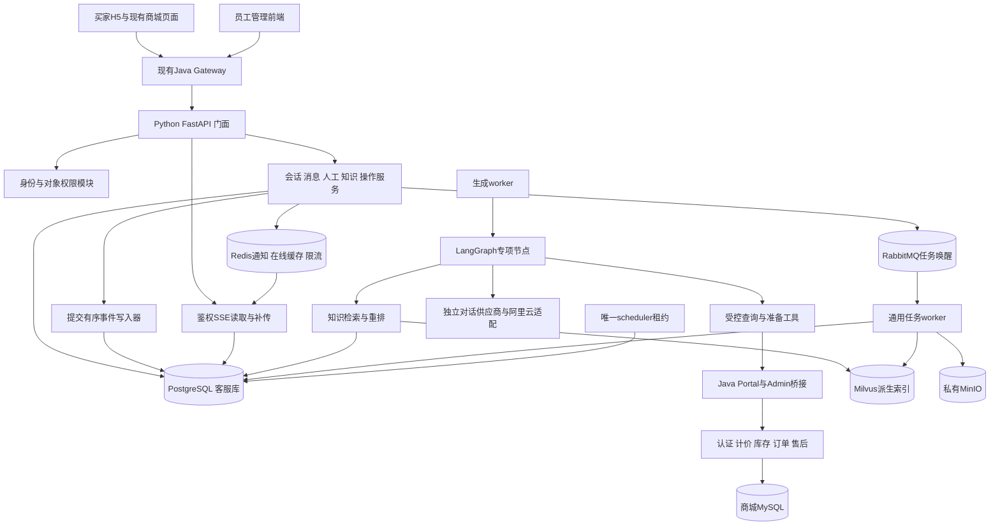

# 商城智能体系统架构与模块设计

架构版本 v0.2，日期 2026-11-11，需求基线 1.1。本文和 architecture 分册共同构成智能体部分的完整系统设计，覆盖 P0、P1、P2 全部范围。架构确定各模块怎样协作、数据由谁负责、接口怎样落地、失败后怎样恢复，以及开发和验收的顺序。

交付形态为现有商城上的独立 Python 客服与业务助手。Java 负责认证、商品、计价、库存、购物车、订单、售后和模拟物流；Python 负责客服会话、人工接待、知识、模型编排和受控业务准备。模型生成文本与工具计划，用户确认服务负责确认，Java 事务负责业务结果。

本文描述完整目标结构，后文现状表保留设计时的基线。2026-11-11 已实施 Python 工程、独立 PostgreSQL、会员身份/商品桥接及 H5 文字/图片闭环，接入真实 GPT、阿里云辅助模型并部署 Milvus。图片理解改由 GPT；向量、重排和语音继续使用阿里云。随后按“整体框架优先”补齐全模块结构、接口责任、完整图和前后端接入位置，最新状态见 [12-整体工程框架与模块落地清单](12-整体工程框架与模块落地清单.md)，图片验收见 [11](11-GPT图片咨询闭环验收.md)。知识、人工及交易等业务与部分运行基础仍需后续实施。

## 1 阅读顺序和设计依据

| 资料 | 本轮使用方式 | 对应输出 |
|---|---|---|
| 商城智能体需求分析与技术设计.docx | 范围与验收依据，原件保持原样 | 18项R、12项U、15项A及C/H功能逐项承接 |
| 01-前端UI设计.md 与 ui/ | 页面、状态、权限、交互与响应式输入 | 前端模块、组件状态和接口映射 |
| 02-数据库设计.md 与 database/ | 字段、约束、索引和数据归属 | 事务边界、锁序、生命周期与架构补充表 |
| 03-接口设计.md 与 api/ | 浏览器门面、Java桥接、SSE、错误和鉴权 | 每个operationId的模块责任及处理规则 |
| 04-需求设计映射.md | 原需求到设计的追踪基础 | 全量架构覆盖矩阵与阶段映射 |
| 05-设计决策与环境.md | 技术约束、候选版本、业务建议和环境证据 | 架构决策D09–D15及实施前验证事项 |
| 现有 mall-swarm、两个前端与 deployment | 当前能力、兼容方式与已知缺口 | 增量接入位置、旧流程回归要求 |

建议依次阅读本篇、模块分册、图编排分册、关键流程分册，然后使用承接矩阵核对具体对象，最后阅读运维验收与第一阶段计划。

| 分册 | 阅读目的 |
|---|---|
| [模块与工程结构](architecture/01-模块与工程结构.md) | 20个模块的职责、目录、内部服务方法、依赖和写入边界 |
| [LangGraph与工具编排](architecture/02-LangGraph与工具编排.md) | 图节点、状态、提示词、工具注册、检索和模型适配 |
| [关键流程与故障恢复](architecture/03-关键流程与故障恢复.md) | 时序、状态机、事务、锁序、签名和故障矩阵 |
| [数据接口与页面承接](architecture/04-数据接口与页面承接.md) | 每项需求、场景、接口、表及页面的责任分配 |
| [部署运维与验收](architecture/05-部署运维与验收.md) | 进程、网络、配置、容量、备份、清理和测试 |
| [第一阶段开发与验收计划](08-第一阶段开发与验收计划.md) | 阶段任务、前置依赖、交付物和完成门槛 |

## 2 目标与范围

系统支持登录咨询、本人历史、文字流式交流、停止和重试、真实商品导购、规则来源、人工接待、知识版本维护、加车、报价下单、取消、订单与模拟物流、明细级退货、图片识别、语音、反馈、配置用量、留存和备份恢复。

单商家自营是全局业务边界。多个员工共用同一商家的权限体系，不增加店铺隔离、商家入驻、结算、平台抽佣。支付、物流和退款均使用演示规则；用户在既有页面手动模拟付款，有权员工审核售后并登记模拟退款。AI不修改地址、商品、库存、促销规则，也不批准退货。

H5为买家验收端，桌面浏览器为后台主验收端。uni-app小程序和原生端的SSE、录音、文件和登录另行适配，不能以H5通过推定其他平台通过。桌面宽屏聊天是H5布局之一，手机窄屏仍需实际测试。

容量目标为10名买家、3名客服同时在线，连续收发至少15分钟；全局最多3个AI生成run，每个会话最多1个活动run。普通接口建议P95小于1秒，单独记录SSH网络、数据库和云模型耗时。目标是验收指标，当前尚无实测通过结论。

## 3 现状与增量接入

### 3.1 已有基础

| 项目 | 当前基础 | 智能体接入位置 |
|---|---|---|
| mall-swarm | Java17、Spring Boot/Cloud、Sa-Token、MyBatis | portal/admin桥接、gateway路由与权限、共享计价和资源服务 |
| mall-admin-web | Vue3、Element Plus、Pinia、Vue Router | /agent/service、knowledge、models、governance、operations |
| mall-app-web | Vue3、uni-app、H5 | pages/agent/chat、checkout、orders以及现有入口 |
| deployment | 本机服务与SSH隧道、云端Compose中间件 | 后续新增Python启停和依赖检查；本轮不改脚本 |
| 云端中间件 | MySQL8.0.35、Redis7、MongoDB7、RabbitMQ3.13、Nacos2.5.1、ES8.18、MinIO | 继续承载原商城，新增独立账号/虚拟主机/私有桶 |

前次只读采样显示服务器8核、约15.1GiB内存，可用约11GiB，磁盘剩余约30GiB；不能据此保证新增向量组件后仍稳定。Docker数据根实际位于 /opt/mallpilot/docker-data，备份不能假定 /var/lib/docker。商城MySQL为76张表；当前商品和订单数量会变化，不把README中的演示数量作为设计约束。

### 3.2 必须承认的能力缺口

1. 智能体API、Java agent-bridge及新增客服数据库尚未实现。
2. 现有确认订单预览与最终订单计算分开；所选优惠券、积分和最终金额需要统一计算器。
3. 现有售后按订单+商品匹配，无法覆盖同商品多明细、7天窗口和完整分摊规则。
4. 网关普通管理路径未全面实现未匹配资源默认拒绝；新增路径必须明确注册并独立拒绝越权。
5. 已有业务修复和未提交修改必须保留。功能存在测试文件并不等于本轮已执行或通过。
6. README中的“本机正在运行”不是实时证据，启停管理器成功也不是全部服务就绪。

这些缺口进入实施任务和验收门槛，不以模型提示词弥补底层事务与权限不足。

## 4 总体逻辑架构

图中的模块是同一Python工程内的逻辑边界。API与worker使用同一领域代码和迁移版本，通过进程隔离长连接、生成任务和CPU解析。当前容量下不为每个智能体拆独立服务；也不把框架节点当作可独立执行业务事务的服务。

### 4.1 核心信任链

浏览器携带当前会员或员工令牌到门面；Python经Java桥接复核稳定身份和权限，再构造只在服务内部传递的Principal。模型和浏览器提交的member_id、x-user-id、role、任意URL均不能建立身份。

模型只能取得非秘密的工具输入、允许展示的业务摘要和已授权知识。工具执行器在可信上下文中补入主体，Java独立复核归属。用户点击确认的HTTP路径与模型工具路径分开；模型工具注册表不包含confirm、付款、售后审核、模拟退款或通用HTTP/SQL工具。

### 4.2 三种事实

| 事实类型 | 最终来源 | 不可替代来源 |
|---|---|---|
| 商品价格、库存、购物车、订单、售后、物流 | Java服务与MySQL事务 | 模型文字、图片OCR、向量切片、Python action缓存 |
| 会话、消息、接待、知识活动版本、控制世代 | PostgreSQL客服领域表 | Redis在线缓存、进程内队列、浏览器状态、图检查点 |
| 供应商调用与费用 | 适配器记录和供应商报告 | 前端示例统计、未报告用量的0值、仅客户端计时 |

## 5 运行进程与职责

| 进程 | 建议首版数量 | 主要职责 | 不能承担 |
|---|---|---|---|
| API | 1个Uvicorn worker | 普通HTTP、鉴权、事务命令、SSE、首次确认调用 | 进程内长期队列、文档解析、恢复后重放商城写入 |
| generation-worker | 1个进程、最多3个活动run | 调度run、LangGraph、流式生成、工具查询与准备 | 自动确认和人工审批 |
| job-worker | 1个进程、解析并行1 | 解析、索引、清理、结果核对、outbox发布 | 普通会员身份推导、任意命令执行 |
| scheduler | 1个有效租约持有者 | 周期扫描、过期标记、任务补唤醒、核对重调度 | 依靠本地内存认为全局唯一 |
| Java业务outbox发布器 | 现有Java服务内受控任务 | 事务后可靠投递延迟取消等业务通知 | 把MQ发布成功当订单成功 |

API可在后续增加进程，但必须完成共享状态、Redis通知、全局名额和连接恢复测试。数据库池按进程数累计计算，不能每个进程各配置20连接而忽略总量。

## 6 模块目录

| 模块 | 主要职责 | 主要需求 |
|---|---|---|
| M01 身份与授权 | Java身份桥接、RBAC、对象归属、服务签名 | R01 R06 R18 |
| M02 会话与历史 | 创建、列表、入口、改名、删除、已读 | R02 R17 |
| M03 消息与事件 | 消息幂等、快照、提交有序事件、SSE | R03 R06 R18 |
| M04 智能体运行 | run、名额、图状态、停止、恢复 | R03 R04 R05 R18 |
| M05 工具与商城查询 | 工具白名单、商品/订单查询、结构化业务事实 | R04 R08 R09 R10 R12 |
| M06 确认与结果核对 | 不可变action、首次执行、仅核对、负向封闭 | R08 R09 R11 R12 R18 |
| M07 人工接待 | 排队、领取、转交、关闭、在线与备注 | R06 |
| M08 知识管理 | 原件、版本、解析、质检、发布与禁用 | R05 R07 |
| M09 知识检索 | 父子召回、授权过滤、重排与来源 | R05 R07 |
| M10 媒体与附件 | 图片、ASR、TTS、私有字节、保护引用 | R13 R14 R17 |
| M11 模型与提示词 | 能力配置、不可变版本、额度、供应商适配 | R16 |
| M12 留存与删除 | 试算、批次、tombstone、跨存储清理 | R02 R17 R18 |
| M13 审计与统计 | 追踪、用量、反馈、受限访问审计 | R15 R16 R18 |
| M14 后台任务 | 任务租约、MQ唤醒、重试、调度 | R07 R17 R18 |
| M15 买家前端 | B01–B05、typed消息、确认和恢复 | R01–R15 |
| M16 员工前端 | A01–A05、权限菜单、人工操作和治理 | R06 R07 R10 R12 R16 R17 |
| M17 Java查询桥接 | 身份、可见商品、本人订单、代查摘要 | R01 R04 R06 R10 |
| M18 Java交易桥接 | 统一报价、幂等操作、库存优惠积分事务 | R08 R09 R11 R18 |
| M19 Java售后与物流 | 明细级退货、规则分摊、人工阶段、模拟节点 | R10 R12 |
| M20 部署与恢复 | 网络、配置、迁移、备份、恢复与容量 | R18 |

各模块的内部方法、数据访问和依赖见01分册；全部接口和表的归属见04分册。M01/M13/M14是横切能力，不能因此获得其他模块数据的任意修改权限。

## 7 请求与数据流

### 7.1 咨询流

浏览器POST消息 → Java复核身份 → 同事务保存消息、run和accepted/queued事件 → 返回稳定message_id/run_id → worker领取全局名额 → 构建图上下文 → 只读查询/知识检索 → 合批保存可见delta → SSE补传 → 完整消息与run终态提交。SSE断开不等于停止生成；用户停止是独立命令。

### 7.2 交易流

图或页面选择参数 → Java准备/报价 → Python不可变action → 用户点击confirm → 同事务写确认审计、EXECUTING、dispatch → 首次发送者使用当前会员令牌调用Java一次 → MySQL操作主键锁与业务同事务 → Python记录实际结果。响应不确定时只调用原编号核对接口；恢复不重新发起执行业务请求。

### 7.3 人工流

申请handoff → 排队持久化 → 员工领取锁员工与会话 → 更新接待、control_epoch和待确认卡 → 原AI失效 → 人工消息与已读同一历史体系 → 业务摘要通过员工令牌和用途限定grant访问 → 转交或关闭留审计。内部备注存独立表，不进入买家事件或图上下文。

### 7.4 知识流

员工上传私有原件/文本 → 创建独立版本 → 解析预览与校正 → 新集合/版本切片构建 → 质检通过 → 原子更新活动版本 → 新回答使用活动版本。检索后和输出前均复核授权、enabled与活动版本；禁用立即生效，不等待Milvus物理删除。

## 8 三项可靠性方案

### 8.1 提交有序事件游标

数据库sequence/identity的ID分配不等于提交顺序。设计新增ag_event_clock单行，所有可见事件事务在取得业务锁并完成验证后，最后锁该行分配event_id并持锁到提交。后续事务只能在前序事务提交或回滚后分配，从而消除较小ID迟提交导致补传漏读的问题。SSE仍允许游标间隙，不能要求连续整数。

快照在同一REPEATABLE READ事务内读取业务状态与时钟高水位；返回的event_cursor覆盖该快照，之后订阅大于游标的事件。删除历史事件仅删除连续前缀并维护replay_floor；事件被删除、权限撤销或对象删除都必须重新鉴权。详细SQL、锁序和反例见03分册。

### 8.2 确认后崩溃与业务结果核对

新增ag_action_dispatch保存确认事实与核对调度，不保存会员令牌。确认后的首次执行只尝试一次；后台恢复使用服务签名和原操作限定的仅核对凭据，不具备创建订单等执行能力。

新增reconcileBridgeOperation支持QUERY_ONLY和FINALIZE_IF_ABSENT。后者竞争与execute相同的MySQL操作主键：在途事务先完成则返回真实结果；没有已提交操作则原子写REJECTED/RECOVERY_NOT_EXECUTED，永久阻止迟到执行。锁超时保持UNKNOWN，不能把查不到当作确定失败。这样既避免重复业务，也能结束“确认已提交但请求根本未发出”的长期悬挂。

### 8.3 配置不可变版本

ag_model_profile保存当前可编辑状态，ag_model_profile_version保存不可变版本。每次保存生成完整公开参数快照、不可变端点注册版本、秘密版本引用和兼容证据；ag_model_call与知识embedding配置通过组合外键绑定版本。运行中的run使用config_snapshot，不因后台切换静默改模型。

普通接口仅返回脱敏公开信息；秘密字节不进PostgreSQL、图检查点、RabbitMQ消息和日志。秘密版本引用只供受限适配器解析。模型配置版本不等于供应商模型权重固定，供应商未提供快照时必须记录这一限制。

## 9 状态与一致性约束

1. Conversation.version用于对象乐观锁；control_epoch用于接管、关闭、删除等生成控制；memory_epoch用于删除/到期后的上下文失效。三者不能混用。
2. 普通改名、已读和合法新消息不应因为version变化误停当前run；旧run_id、旧control_epoch、旧fencing_token的输出全部拒绝。
3. state=AI_ACTIVE或WAITING_HUMAN下waiting_ai_enabled决定是否允许自动AI回复；HUMAN_ACTIVE和CLOSED不自动生成。执行中的业务不因接管假装回滚。
4. action_id=operation_no，主体、类型、规范化参数、哈希、报价和确认期限绑定；确认接口只接收版本，不接受替换价格/数量。
5. Java业务结果与业务数据同一MySQL事务；PostgreSQL action结果是副本。未提交IN_TX不可当业务终态，异常已提交IN_TX转人工核查。
6. PostgreSQL保存客服可见状态与任务事实，MySQL保存商城业务结果；RabbitMQ负责唤醒，Redis负责通知与缓存。MQ丢失由数据库扫描补唤醒，通知重复按稳定ID去重。
7. 模型不能取得内部备注、任意会员ID、签名密钥、确认/核对凭据、完整地址和原始登录令牌。
8. 文件物理删除必须复核引用保护，执行未知的售后凭证不能因聊天删除或租约到期被清理。

## 10 数据设计与接口变化

原25张客服表继续保留，架构细化增加4张：ag_event_clock、ag_action_dispatch、ag_model_profile_version、ag_quota_reservation，共29张。增加control_epoch、run.config_snapshot、任务fencing字段、embedding_profile_version及相关外键。

MySQL原7张增量表与1张售后扩展继续保留，增加oms_agent_request_dedupe和oms_agent_business_outbox，共9张新增表及1张已有表扩展。前者让员工物流/售后操作与幂等结果同事务提交；后者覆盖订单创建后延迟取消等可靠通知，消费者仍需状态条件和幂等。

原114个操作保留，新增listModelProfileVersions与reconcileBridgeOperation，共116个操作。ModelProfileUpdate增加model_name；Conversation、Run、Action与SSE新增control_epoch。普通22个Java桥接的双重身份要求保留，新增仅核对桥接使用专门的BridgeSignature+OperationReceipt组合。

Snapshot增加同一RR事务内的recent_messages、history_cursor、handoff和read_position；ConversationPage/HandoffPage/JobPage增加event_cursor。这样首次消息正文、控制状态和补传边界有一致起点，员工多个列表从最低水位重放并按版本归并。

所有变化同步到OpenAPI、SSE Schema、DDL、字段目录和生成源。v1.sql尚未执行，因此保留文件名作为目标定义；一旦有数据库实例迁移，必须新增有校验和的版本化迁移，不能覆盖已执行版本。

## 11 安全与隐私设计

身份链、对象归属和员工用途必须在API层、领域服务和Java桥接边界校验；隐藏菜单不替代服务端拒绝。网关移除伪造内部头，直接访问桥接仍需签名。CORS仅允许明确本机前端源，长连接用Authorization头，令牌不进入URL。

输出使用typed消息块。Markdown禁任意HTML、脚本、危险协议和任意外链；商品图走受控来源，用户附件走鉴权字节。模型产生的来源、业务成功和价格必须从结构化对象取值，不根据“已成功”文字改变页面状态。

文件检测实际MIME、字节上限、页数、归属、解析时间及内存；文件名不参与路径拼接。模型接收图像/音频由适配器上传受控字节，不把localhost地址当公网模型可读取URL。

## 12 版本与依赖策略

Python3.13、FastAPI、Pydantic2、SQLAlchemy2、Psycopg3、LangGraph和相关候选版本沿用需求文档。候选解析记录不代表可运行；实施时在隔离环境生成uv.lock并验证Windows音频、Milvus客户端/服务端和检查点组件组合。禁止直接继承参考工程Python3.14的依赖集合。

对话模型保留gpt-6.1-sol指定名称，按独立供应商凭据和Responses方向设计；工具流、结构化输出、取消、用量和错误兼容性是必测项。阿里云各能力独立注册地域、端点和模型，不自动替换为其他模型或把一种兼容地址套用于全部能力。

本轮官方OpenAI文档请求返回403，未得到新的官方可用性证据；本文不把Codex内可选模型等同于商城API可用，也不读取其他Codex会话或凭据。当前文档仅引用技术入口供实施核查，未声称所有候选版本已验证。

## 13 分阶段实施与验收

| 阶段 | 目标 | 关键门槛 |
|---|---|---|
| S0 基础验证 | 基线、隔离依赖、迁移、身份桥接、签名与框架探针 | 迁移恢复可复现，供应商能力证据明确 |
| S1 核心咨询 | 登录、历史、文字/SSE、商品导购、知识发布、人工接待、基础配置 | 两买家隔离、3run排队、停止/接管、知识禁用和恢复 |
| S2 交易与售后 | 加车、准确报价、订单、取消、明细退货、人工物流售后 | 事务幂等、资源竞争、未知结果封闭和金额分摊 |
| S3 媒体与治理 | 图片、语音、反馈、留存试算与清理 | 附件保护、凭证对账、删除记忆一致 |
| S4 完整验收 | 全范围容量、故障、备份恢复和演示脚本 | A01–A15全部有可核对结果，未测不能标通过 |

R18等基础可靠性跨阶段实施，备份与删除防护从首批数据进入系统就需要，不推迟到最终阶段才设计。阶段映射表示交付顺序，不缩减P0/P1/P2完整范围。

## 14 开发前固定事项与完成标准

D03七天口径和D04金额分摊仍为业务建议，应在S2前通过边界样例固定；供应商URL、地域、权限、费用单位及能力需要实际配置验证。上述不妨碍开展S0/S1基础开发，也不能在缺少证据时开放相应业务写入。

架构设计的完成标准是：每个需求和原验收场景有责任模块；每个接口有服务边界、鉴权和返回事实来源；每张表有写入责任、事务与清理策略；每个页面有数据来源和错误恢复；关键故障有确定处理和可执行验收条件。本包的静态检查验证这些引用与覆盖，运行正确性留待实施后验证。

架构变更通过D编号、契约版本、迁移版本和覆盖目录共同维护。涉及范围、业务结果或验收标准的变化升级需求基线；内部目录、方法或部署参数调整在设计版本记录。生成器更新后应先生成数据/接口/说明，再生成架构矩阵、执行检查，最后重建离线设计入口。
