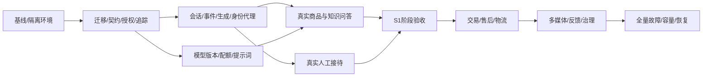

# 智能体第一阶段开发与验收计划

架构v0.2，2026-11-11，需求基线1.1。本计划将完整需求拆成可验收的阶段，不删减P0/P1/P2。首阶段定义为S0基础+S1文字咨询、真实导购、有据知识与真实人工闭环；确认业务写入在S2，多媒体/反馈及完整留存界面在S3，整体可靠性与恢复在S4复验。

实施进展：首条咨询闭环已完成，已接入 GPT、辅助模型、Milvus 与图片咨询；全模块结构位置已补齐。最新结构/运行/业务差异见 [12-整体工程框架与模块落地清单](12-整体工程框架与模块落地清单.md)。S0/S1 仍只有部分任务落地；下文是原阶段计划，图片因用户安排提前实施，不能据此推定其他阶段完成。当前按用户要求先补运行基础，再填具体业务。

## 1 阶段目标与进入条件

第一阶段结束应能由两名真实登录买家分别咨询，查询实际可见商品，获得带来源的规则回答，断线后恢复已接收消息，停止/重试不混乱，并转给真正的员工领取和回复。运营能解析、预览、构建、发布和禁用知识；管理员能维护基本模型/提示词与额度并查看受限审计。

第一阶段不开放AI交易确认、员工售后写入、模拟物流维护、图片识别、ASR/TTS和完整治理执行按钮；这些页面有分阶段状态，不能以演示按钮伪装成功。删除可见性、权限、日志脱敏、额度和备份基础从S0/S1开始，不留到最后补。

进入条件：保存当前业务修改的基线；建立隔离库/账号/样例；明确指定模型独立接入参数；确定Python3.13锁定依赖可运行。供应商暂不可用时先用显式测试适配器完成流程，真实模型接入门槛仍待验证，不记为完成。

## 2 总体依赖和顺序

不安排没有依据的固定工期。任务粒度以一个可验证用例为单位，完成对应测试和受影响回归再进入下一项。遇到无法确认的修复按原实施约束处理，不整体重置覆盖已有工作。

## 3 S0基础任务

| 任务 | 交付物 | 依赖 | 完成门槛 |
|---|---|---|---|
| S0-01 保存源码/设计/数据库基线 | source-lock、构建号、备份/恢复路径、已有修改清单 | 无 | 能准确识别本轮与已有业务改动 |
| S0-02 创建Python工程与锁依赖 | 01分册目录、pyproject、uv.lock、类型/格式检查 | 01 | Python3.13真实启动，依赖版本记录 |
| S0-03 隔离依赖与连接 | 测试PG/MySQL/vhost/桶/集合及最小账号 | 01 | 不触碰现有业务数据，隧道与握手分别核验 |
| S0-04 版本化迁移 | PG29目标表、checkpoint独立schema；MySQL增量分阶段迁移 | 02/03 | 隔离库执行、FK/枚举/索引/回退方案验证 |
| S0-05 Java身份和签名 | 两域identity、网关默认拒绝、HMAC/nonce | 02/03 | 两买家与多角色越权反例通过 |
| S0-06 公共契约和客户端 | OpenAPI DTO、统一错误、request_id、大ID/金额/时区 | 04/05 | Java/Python/前端共同样例一致 |
| S0-07 PG事务与事件写入器 | UoW、锁序、ag_event_clock、RR快照 | 04/06 | 并发提交倒序反例不漏事件；回滚与410通过 |
| S0-08 任务/租约与进程骨架 | job-worker/scheduler、fencing、MQ补唤醒 | 04/07 | 重复投递不重复工作，旧租约不能写 |
| S0-09 日志/配置/秘密/探针 | 脱敏日志、类型配置、能力状态、备份清单 | 02/05 | 不打印Bearer/secret，探针不付费 |
| S0-10 模型兼容验证 | 六能力分别记录；先完成DIALOG/embedding/rerank | 02/09 | 流式/工具/结构化/usage/取消证据，不可用明确标记 |

29表为最终目标结构，可在空隔离库一次建齐以提前核验，也可用分阶段迁移；S1只激活其用例需要的数据和API。不能因表已存在宣称S2/S3功能完成。MySQL交易表可先迁移但对应桥接写入口必须关闭。

## 4 S1实现任务

| 任务 | 页面/模块 | 主要operationId | 数据与验收重点 |
|---|---|---|---|
| S1-01 入口与本人会话 | B01 B02 / M01 M02 | memberMe、createConversation、listConversations、getConversation、renameConversation、deleteConversation | ag_conversation/read_cursor/tombstone；上下文归属、删除不可见 |
| S1-02 消息与SSE | B02 / M03 | sendMemberMessage、listMessages、updateReadCursor、memberEvents | ag_message/event_outbox/event_clock/request_dedupe；提交后接收、offset与重连 |
| S1-03 run与受控图 | B02 / M04 M05 | getRun、stopRun、retryRun | run/slot/config_snapshot；3全局+1会话、停止与重试不执行业务 |
| S1-04 真实商品导购 | B01 B03 / M05 M17 | searchProducts、getProduct、bridgeProducts、bridgeProductDetail | 商品上下架/可见性/真实SKU与预算；卡片仅查看 |
| S1-05 模型/提示词/额度 | A03 / M11 M13 | list/create/update/activateModelProfile、listModelProfileVersions、list/create/publishPrompt、getStatistics | 不可变版本、配额预留、秘密不回传、发布权限 |
| S1-06 知识原件与解析 | A02 / M08 M10 M14 | uploadStaffAttachment、createKBDocument、createKBVersion、parseKBVersion、previewKBVersion、editKBPreview | 文件校验、20MB/页数、TXT/PDF/DOCX、可编辑预览、扫描PDF提示 |
| S1-07 构建/发布/检索 | A02 B02 / M08 M09 | buildKBVersion、publishKBVersion、setKBEnabled、readCitation、listJobs/getJob/retryJob | 旧活动版本保留、父子块、embedding版本、来源停用复核 |
| S1-08 排队与接管 | B02 A01 / M07 | requestHandoff、withdrawHandoff、setWaitingAI、listHandoffs、claimHandoff | handoff/conversation/control_epoch；双客服抢单和AI互斥 |
| S1-09 人工回复与上下文 | A01 / M07 M17 | sendStaffMessage、adminListMessages、getStaffBusinessContext、listStaffNotes/createStaffNote、adminReadCursor/adminEvents | 真实消息、用途限定员工代查、内部备注隔离 |
| S1-10 客服状态与转交 | A01 A04 / M07 | listStaff、setPresence、presenceHeartbeat、updateStaffProfile、transferHandoff、closeHandoff | 容量/租约/目标权限/关闭原因，掉线保留归属 |
| S1-11 最小治理与观测 | A04 / M12 M13 M20 | getSettings/updateSettings、listAuditLogs | 删除清理基础、额度/模型故障、任务和审计可查 |
| S1-12 页面整合与回归 | B01 B02 B03 A01 A02 A03 A04 / M15 M16 | 对应矩阵内S1接口全集 | 窄屏/键盘/错误/权限/空状态，旧商城入口回归 |

上表用组合简称展示任务，精确operationId及全部方法路径以architecture/04分册和coverage.json为准；例如createModelProfile属于精确名字，不能生成名为“createModel”的新接口。S1授权范围内的接口必须全部联调，不能只实现表中举例。

## 5 首阶段页面范围

| 页面 | S1必须可用 | 后续激活 |
|---|---|---|
| B01入口 | 未登录引导、我的/商品/订单入口上下文校验 | 订单深入查询S2 |
| B02会话 | 历史、发送、流式、来源、停止、重试、已读、删除、人工 | 图片语音/反馈S3，业务卡S2 |
| B03商品 | 真实列表/详情/对比/SKU展示 | 确认加车S2 |
| B04结算 | 保留现有商城流程与入口 | agent精确报价、确认下单S2 |
| B05订单售后 | 保留现有商城页面，不宣称agent链路已验收 | agent本人订单/物流/取消/退货S2 |
| A01工作台 | 等待/我的/历史、文字接待、上下文、备注、转交/关闭 | 图片回复S3 |
| A02知识 | 完整原件/解析/预览/构建/发布/停用与失败重试 | 后续仅优化，不缺核心步骤 |
| A03模型 | 非秘密配置、不可变历史、提示词、用量和限额 | 媒体能力实际激活S3 |
| A04治理 | 权限内配置、客服资料、审计/任务只读与必要重试 | 留存试算执行与备份验证UI S3/S4 |
| A05业务操作 | 暂不激活新agent人工写链路 | 模拟物流、售后审核/收货/模拟退款S2 |

原型8入口承接10逻辑页面：B01/B02/B03通过入口、聊天和弹层组合，不额外发明第9/10路由。正式路由复用现有前端结构，原型的场景栏不进入产品。具体组件、状态和页面接口在01分册与04矩阵固定。

## 6 S1验收清单与门槛

| 检查 | 样例与故障 | 对应验收范围 |
|---|---|---|
| G1 身份隔离 | 两买家换会话ID/来源/附件、不同员工角色、伪造身份头 | A01已实现端点完整通过；后续端点S2/S3继续 |
| G2 消息持久与事件 | 重复发送、响应丢失、提交交错、SSE断线、410与RR快照 | A15文字子集、A09历史已读删除子集 |
| G3 图与生成 | 三run+第四等待可取消、同会话限一、停止/重试、broker/worker重启 | A08初步容量、A15，完整混合负载S4 |
| G4 商品/知识 | 预算/缺参数/无商品/无依据/冲突/恶意文档、禁用输出竞争 | A02、A10 |
| G5 人工 | 两客服抢单、真实回复、独立备注、员工代查、掉线、转交/关闭 | A06文字接待全链路 |
| G6 配置和额度 | 变更历史追踪、秘密读取、并发超额、未知usage、模型不可用 | A12首阶段能力子集 |
| G7 删除与恢复基础 | 删除后不能读/进入上下文、旧checkpoint不恢复、备份样例可读 | A09/A13/A14基础子集，完整保护与恢复S3/S4 |
| G8 UI与旧功能 | 真浏览器H5窄屏、管理桌面、登录与商品跳转回归 | C/H当前范围，视觉/交互证据 |

阶段结束要求：上表无越权、无丢失已接收消息、无旧AI越过接管、无虚假业务成功；所有已激活接口有正常/非法状态/重复/权限/故障证据；未激活功能在权限与服务路由层关闭。记录剩余需求及未测能力，不把“页面能打开”当阶段完成。

## 7 S2交易、售后与物流

S2-01先补现有商城共享计价、库存锁定、优惠券积分、支付取消竞争与延迟取消outbox；S2-02实现quote/operation/receipt核对和action状态；S2-03确认加车及DIRECT/CART下单；S2-04本人订单/模拟物流查询与确认取消；S2-05明细退货、7天边界与分摊规则；S2-06员工物流节点与审核/收到货/模拟退款，以及Java员工请求幂等。

进入S2前固定D03/D04边界样例，保存明确口径。验收A03、A04、A05、A11，并扩展A01/A06/A12/A14/A15到交易故障。必须在A/B/C三个提交点注入崩溃、等待同operation锁、原子封闭未执行及迟到execute，核对资源与业务结果一次性。

## 8 S3媒体、反馈与治理

实现私有图片/凭证、视觉理解、ASR编辑后发送、主动TTS、反馈；完成保留试算/确认执行、受保护引用、跨存储清理、媒体缓存和孤儿回收界面。先做授权/保护，再开放字节访问和清理执行。知识原件上传已在S1实现，不重复设计另一套附件系统。

验收A07、A09完整反馈、A13完整保留；扩展A01附件权限、A12媒体额度、A15媒体失败降级。原始录音/TTS7天、普通文字/图片90天到期通过可控时间数据验证，不需要真实等待90天。确认业务保护引用与聊天删除竞争不会删售后凭证。

## 9 S4完整发布验收

补齐F01–F27、全混合容量、供应商限制清单、隔离备份恢复及真实UI视觉检查。A01–A15全部记录通过/未通过/未测试/受供应商限制，P0/P1/P2均覆盖。A14必须有恢复执行证据，不能只校验备份文件存在；A08至少15分钟真实持续负载，不能只短时发13个请求。

## 10 契约收口与变更规则

本轮以架构v0.2同步29PG表、9MySQL新增表及1表扩展、116接口。原114个operationId保持，新增listModelProfileVersions和reconcileBridgeOperation。新增control_epoch、不可变模型版本、job栅栏、dispatch和额度账本；原型编辑model_name及移动点击目标对齐。精确差异见04分册与架构契约扩展源文件。

实施中新功能边界/业务结果/验收变化更新需求基线与变更记录；单纯字段、接口或布局细化同步UI/API/DDL/矩阵/测试，不另造第二份互相冲突的文档。每个任务完成后用coverage.json定位影响对象，先更新源生成器，再生成派生资料并运行静态检查。

建议下一项实际实施从S0-01至S0-07开始，先获得可验证的身份、事务和事件基础，再接图和页面。架构资料已经给出开发顺序；本次不直接进入业务代码修改。
