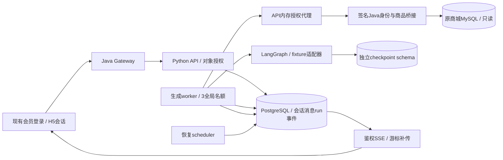

# 架构骨架实施与最小闭环验收

2026-11-11，实施版本 `architecture-0.1`，目标设计 v0.2 / 需求基线 1.1。本文记录实际交付，与 07、08 中的完整目标和待开发任务区分。当前是第一条架构链路完成，S0、S1 均未整体验收。

后续更新：本文保留初始 fixture 阶段证据；当前已接入真实 GPT，并验证阿里云辅助模型与 Milvus，最新状态见 [10-模型接入与依赖验收](10-模型接入与依赖验收.md)。下文“未接入模型”等表述仅指本次初始骨架验收时点。

## 交付结果

已建立独立 `mall-agent` Python 工程、分层代码、锁定依赖、版本迁移和三类运行进程。在现有商城上新增会员身份/商品签名桥接、受限网关路由，以及 H5 会话页面。工程结构、精确启动和测试命令见 [mall-agent/README](../mall-agent/README.md)。

## 实际启用范围

| 部分 | 本轮交付 | 后续缺口 |
|---|---|---|
| 身份与边界 | 现有会员令牌复核、对象归属404、HMAC/时间戳/nonce、内部代理不可经网关访问 | 员工身份、角色矩阵、完整授权反例 |
| 会话与消息 | 创建、列表、历史、消息幂等、稳定编号、同事务事件 | 改名、删除、已读、完整上下文入口 |
| run | 3个全局槽位、1会话1活动run、停止、租约与fencing、重启中断 | retry接口、完整故障与调度策略 |
| 图与模型 | LangGraph真实运行、PG检查点、显式fixture回复 | 真实模型流式/工具/结构化/usage、提示词与额度 |
| 商城查询 | 已登录会员、真实上架商品样本和真实价格 | 完整query/预算筛选、详情/SKU/分页、订单工具 |
| H5 | 会员入口、新会话/历史、发送、停止、持久化流式显示 | 全量UI设计、商品卡片、手机布局和端兼容验收 |
| 数据库 | 29张领域表、迁移0001、独立checkpoint schema、运行账号无DDL权限 | 备份还原演练、清理及未来迁移策略 |
| 其余模块 | 20模块责任目录与外部能力协议 | 知识、人工、媒体、交易、员工前端尚未激活 |

回答固定标明“架构联调测试回复，非模型生成”，没有调用大模型或产生模型费用。商品数据是真实读取，但问题意图理解和动态工具编排尚未实现。未用虚假成功接口代替未来模块。

## 验收记录

| 检查 | 结果与证据 |
|---|---|
| Python | 8项通过：幂等并发/冲突、对象隔离、游标防篡改、凭据生命周期、签名、输入、提交顺序、3名额/旧worker隔离及API授权丢失恢复；详见tests |
| Java | 本轮定向桥接3项、会员响应安全2项、网关白名单5项通过；不将历史测试报告计入本轮运行总数 |
| 前端 | vue-tsc通过；H5生产构建通过，已有Sass弃用提示保留 |
| 真实网关HTTP | 会员身份、无效令牌、未签名桥接拒绝、内部代理隔离、创建/发送幂等、Schema合规SSE、历史/fixture标签、游标补传、停止终态通过 |
| 重启持久化 | 真实API重启后读取上一轮会话成功；集成测试另验证未完成任务中断、名额释放、旧worker不能落库、新上下文任务不被误中断 |
| 浏览器 | 使用已登录H5会员创建会话、发送、展示真实商品回复、刷新保留历史、第二次发送成功 |
| 进程管理 | 停止验证覆盖Python启动器及子解释器；最新Java包暂存后重启加载 |

本机证据：`deployment/.run/agent-smoke.json`、`agent-browser-proof.png`、`agent-server-inventory.json` 和 `agent-runtime-manifest.json`。这些运行产物被 Git 忽略，不包含认证令牌；复现方式见工程 README。截图证明已验证的 H5 页面，不代替其他 UI 状态测试。

## 部署与恢复边界

云端新增 `mall-agent-postgres`（PostgreSQL 16 Alpine），独立数据卷、数据库和账号，绑定 `127.0.0.1:15432`，通过 SSH 到本机；原七类商城中间件保留。应用继续本机运行，未部署 Python 到公网。PostgreSQL 限额为 1 GiB / 1.5 CPU。实际镜像摘要、版本、构建包哈希记录在运行清单；供应商镜像镜像站用于下载，本轮不重建既有中间件。

运行账号仅具所需DML和迁移版本读取权限；建表与checkpoint库初始化通过迁移账号执行。令牌只在API内存中短时保存，不进入SQL、事件或图状态；worker仅借用一次允许的只读操作。API重启时，将旧授权世代下的未完成任务中断；用户可保留历史并重新发送。当前限定单API进程。

readyz 只检查数据库、迁移和槽位结构，不能代表下游端到端健康。生成/恢复进程由本机管理器重启，故障恢复依赖持久化状态；未完成备份还原、数据库断线全矩阵或15分钟容量测试，不能宣称具备生产恢复能力。

## 下一步开发顺序

1. 完成 S0 剩余基础：第二真实买家隔离、员工身份与权限、配置日志检查、备份还原演练、统一运行状态检查；固定本次契约与迁移基线。
2. 在现有 DialogProvider 边界接入真实对话模型，逐项验证流式、取消、工具、结构化输出、usage和超时；补齐提示词版本与额度。先保持商品工具只读。
3. 完成真实导购：商品筛选、详情与SKU桥接、结构化商品卡和正确性反例，避免用固定商品样本充当语义导购。
4. 按 M08/M09 增加知识解析、版本发布/禁用、检索与来源校验；确有用例后引入向量组件。
5. 接通 M07/M16 真实员工领取和回复，与AI停止共用控制世代；随后完成两买家/员工、断线恢复和容量的S1验收。
6. S1通过后再进入S2交易确认，先统一Java计价与业务幂等，再实现action确认/核对；沿用原设计的交易边界。

无需继续扩大静态设计范围。后续每次只激活一个可验收用例，更新模块状态和证据；新增模块不需要另起一套会话、事件、身份或部署机制。
