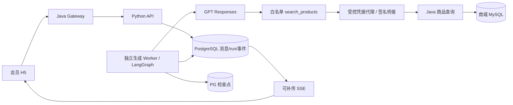

# 模型接入与依赖验收

2026-11-11，运行版本 `models-0.2`。本记录接续 [09 架构骨架验收](09-架构骨架实施与最小闭环验收.md)，保留该阶段真实结果。随后按用户决定将图片理解切换到 GPT，并完成 H5 图片链路；最新状态见 [11-GPT图片咨询闭环验收](11-GPT图片咨询闭环验收.md)，下文阿里云视觉失败及禁用状态属于历史记录。S0、S1 尚未整体验收。

## 当前结果

买家 H5 已通过真实会员登录、GPT 理解问题、调用只读商品工具、读取商城商品、继续生成回答、SSE 展示和历史持久化。对话模型固定为用户指定的 `gpt-6.1-sol`，没有更换成阿里云对话模型。阿里云负责向量、重排、视觉与语音能力。

| 能力 | 实际模型 | 验证结果 | 当前业务启用范围 |
|---|---|---|---|
| 对话/工具规划 | gpt-6.1-sol | Responses 流式、function call、工具结果续写、JSON Schema、usage 通过 | H5 文字咨询；只允许 search_products |
| 文本向量 | text-embedding-v4 | 真实返回 1024 维；写入 Milvus、语义召回通过 | 已接入适配器与独立检索验收；知识业务尚未开放 |
| 重排 | qwen3-rerank | 文本候选及 Milvus 召回结果重排通过 | 已接入适配器；知识回答尚未开放 |
| 图片理解 | qwen3-vl-plus | 供应商返回 HTTP 403，免费额度耗尽/仅免费模式限制 | 配置保留，enabled=false；不可宣称已可用 |
| 语音识别 | qwen3-asr-flash | 真实 WAV 识别为“商城连接测试。” | 适配器通过；上传、录音、转写确认页面未接通 |
| 语音合成 | qwen3-tts-flash | 返回 73004 字节 WAV，并由 ASR 识别通过 | 适配器通过；页面播报流程未接通 |

TTS 初始候选 `qwen-audio-3.1-tts-flash` 请求失败，已固定为同一阿里云账户实际验证通过的 `qwen3-tts-flash`，没有将不可用候选记为通过。视觉问题需要在阿里云控制台恢复相应可用额度或调整该账户限制后重验；本轮没有修改计费设置。

## 端点与秘密配置

| 用途 | Base URL | 适配器追加的路径 |
|---|---|---|
| GPT | https://<YOUR_LLM_ENDPOINT>/v1 | /responses |
| 阿里云兼容接口 | https://<YOUR_ALIYUN_WORKSPACE>.cn-beijing.maas.aliyuncs.com/compatible-mode/v1 | /embeddings、/chat/completions |
| 阿里云原生重排 | https://<YOUR_ALIYUN_WORKSPACE>.cn-beijing.maas.aliyuncs.com/api/v1 | /services/rerank/text-rerank/text-rerank |
| 阿里云原生 TTS | 同上 | /services/aigc/multimodal-generation/generation |

仅主机名不能直接替代 Base URL；兼容接口和原生接口按能力分别使用。密钥存放于本机 `mall-agent/.env`，已被 Git 忽略并限制 Windows ACL；模板为 `mall-agent/.env.example`。数据库、签名桥接等配置继续由本机管理器从原有受忽略配置注入。模型秘密不写入 SQL、图检查点或模型公开快照，数据库只保存秘密版本引用。

TTS 下载只允许已核实的阿里云结果 OSS 域名，使用 HTTPS、不携带模型密钥、不跟随重定向，并限制返回大小。供应商原始错误正文不向会员返回。

## 对话运行与边界



模型选择简短关键词，Java 从真实上架商品中返回最多 5 个样本，模型再据此回答。已在 H5 实际验证 iPhone 查询，返回商品 ID 37、价格 5999.00 元起，刷新后历史保留。价格是该次查询快照，后续仍以 Java 实时结果为准。

现有工具仍缺少完整预算、SKU、规格组合、分页与详情；不是完整语义导购。Milvus 不参与当前商品查询链路。精确商品关键词查询、库存和价格读取可以直接走 Java；语义召回可在后续增加商品派生索引，但最终事实仍须 Java 复核。设计中的 Milvus 主要承接知识切片检索，当前完成的是这项依赖的独立验证。

每次模型调用前持久化预留次数；默认每种能力每天 200 次，UTC 日切。失败或取消后费用不确定的预留保持 UNKNOWN，不能当作免费调用释放。供应商返回的 token/字符等用量按实际记录，缺失保持 NULL。当前是次数上限，不是完整的 token、金额预算或财务对账。

运行限制：全局 3 个生成名额、每会话 1 个活动 run、最多 3 轮模型调用及 3 次商品工具调用、单次输出上限 1536 token、模型超时 60 秒、run 超时 120 秒。停止后通过租约和控制世代阻止旧输出；上游取消不确定时保留短时名额冷却。无自动付费重试或备用模型切换。SSE 按约 64 字分批落库，避免云端数据库隧道上每个 token 单独提交。

`ag_model_profile`、不可变配置版本、提示词版本、run 配置快照、`ag_model_call` 和 `ag_quota_reservation` 已用于此链路。后台模型配置页面、完整权限、额度管理页面和统计仍待开发。隐藏推理和 commentary 不进入买家正文。

## Milvus 实际部署

云端 `/opt/mall-agent-vector/` 为独立栈，使用专用网络、持久卷、etcd 和对象存储，不复用商城 MinIO 桶。

| 容器 | 固定版本 | 资源上限 | 暴露范围 |
|---|---|---|---|
| mall-agent-milvus | milvusdb/milvus:v3.0.5 | 4 GiB / 2 CPU | 云端 127.0.0.1:19530、19091；本机 SSH 转发 |
| mall-agent-etcd | quay.io/coreos/etcd:v3.5.25 | 384 MiB / 0.5 CPU | 仅专用容器网络 |
| mall-agent-vector-minio | milvusdb/minio:RELEASE.2024-12-18T13-15-44Z | 512 MiB / 0.5 CPU | 仅专用容器网络 |

客户端固定 `pymilvus==3.0.2`，服务端返回 `3.0-20261030-af15c80751`。镜像摘要、挂载、健康和资源采样记录在 `deployment/.run/vector-server-inventory.json`。采样时三容器内存约 371/19/116 MiB，服务器可用内存约 10.3 GiB；仅是极少量合成切片下的瞬时结果，不代表批量索引或并发容量通过。

WAL 明确使用内置 Woodpecker，无需新增 Kafka。首次无业务集合的失败初始化留下了 Kafka 选择；已保留其元数据与文件，改用 `mall-agent-v1` 元数据/对象前缀初始化成功。`user.yaml` 必须允许容器内非 root 用户读取，秘密 `.env` 仍限制权限。不得对已有业务实例直接照搬命名空间切换。

认证开启，默认 root 密码已更换；`mall_agent` 为独立数据库，读取和构建账号分离，均无集群管理员权限。生成凭据位于受忽略且限制 ACL 的 `deployment/.run/milvus-env.json`，不写入源码。普通应用暂未加载 root 凭据。专用数据卷位于实际 Docker 根 `/opt/mallpilot/docker-data/volumes/` 下。

`MilvusCandidates` 当前是基础候选适配器：UUID 切片与版本引用、内容摘要、模型配置版本、代际、1024 维 FLAT/COSINE、参数化范围过滤。测试只覆盖 PUBLIC/STAFF 与版本过滤；商品/分类范围、PG 活动版本和权限二次复核、父子块组装、引用与失效处理仍须由后续 M08/M09 实现，所以这不是已上线的 KnowledgeIndex。

## 验收和复现

| 检查 | 本轮结果 |
|---|---|
| Python | 20 项通过；含隔离 PG 集成、供应商错误脱敏、碎片 UTF-8 SSE、隐藏推理、完整终态、工具白名单/身份注入、向量维度、重排范围、次数预留及名额冷却、输出分批 |
| 风格 | Ruff check / format 检查通过 |
| 设计检查 | 16 项基础检查通过；架构脚本 26 项设计检查通过，1 项历史“业务源码未改”快照因已进入授权实施阶段出现差异，未重写快照冒充通过 |
| H5 | vue-tsc 和生产构建通过；真实 GPT 工具查询与刷新保留历史已在浏览器验证 |
| 真实网关 | 会员登录、非法令牌、未签名桥接、内部路由隔离、创建/发送幂等、契约 SSE、真实回答、游标补传、停止终态通过 |
| 向量 | 真实阿里云向量 → 独立集合 → 幂等 upsert → 公开活动版本候选 → 阿里云重排通过 |
| 向量权限 | 员工/旧版本被过滤，只读账号不能删除，构建账号不能建数据库，匿名请求 401 |
| 重启 | API 历史保留、Milvus 持久化数据与过滤的实际重启复验记录见本机证据 |

在管理器运行、SSH 隧道正常时，从 `D:\newshop\mall-agent` 执行：

```powershell
$env:PYTHONPATH='.'
$env:PYTHONUTF8='1'
& .\.venv\Scripts\python.exe -m pytest -q
& .\.venv\Scripts\python.exe scripts/smoke.py
& .\.venv\Scripts\python.exe scripts/verify_models.py
& .\.venv\Scripts\python.exe scripts/verify_vectors.py
# 完成针对相应进程的重启后，不再发起模型请求的持久化复验：
& .\.venv\Scripts\python.exe scripts/smoke.py --verify-persistence
& .\.venv\Scripts\python.exe scripts/verify_vectors.py --verify-persistence
```

pytest 强制 fixture，不调用真实付费模型。正常 smoke、verify_models 和首次 verify_vectors 会发起真实模型调用；向量验证保留带 probe 名称的合成集合，不更改商城数据。重启复验复用已存数据，不重新向量化。准备脚本为 `deployment/prepare-milvus.cjs` 与 `scripts/prepare_vector_access.py`，已有环境不需反复初始化。

证据目录 `deployment/.run/` 被 Git 忽略：`model-compatibility.json`、`agent-smoke.json`、`models-browser-proof.png`、`vector-smoke.json`、`vector-server-inventory.json`、`models-runtime-manifest.json`。早期 probe 只说明当时的连通性，不替代最终验收。未做完整备份还原、并发容量、语义正确性评测或生产发布。

`docs/_source/validate_architecture.py` 保留最初只读设计评审的源码快照检查。当前重新运行会因已实施的网关、页面和部署修改报告该项差异；这不是业务回归测试失败。`architecture-validation.json` 保留真实结果，原需求 Word 文件未修改；本轮运行验收以本页及独立代码/网关/向量证据为准。

## 下一步

1. 完成 M05 只读导购：预算/规格筛选、商品详情与 SKU、结构化商品卡、无结果与歧义反例。继续让 Java 返回实时价格和库存。
2. 用现有 PG、模型和 Milvus 建立 M08/M09 的第一条知识闭环：文本入库、分块、新版本构建、发布、带引用回答、停用立即失效；补齐 PG 授权与活动版本双重复核。
3. 补齐员工权限和人工接待、两买家隔离及恢复验收，再完成 S1。语音页面和图片功能按阶段接入；图片先解决供应商账户限制。
4. S1 通过后进入确认式交易，不把当前只读工具扩展为模型直接执行订单、支付或退款。
