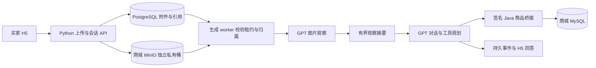

# GPT 图片咨询闭环验收

2026-11-11，运行版本 `vision-0.3`。本记录接续 [10 模型与依赖验收](10-模型接入与依赖验收.md)。按用户最新决定，文字对话和图片理解均使用 GPT；向量、重排、语音识别和语音合成继续使用阿里云。当前交付是图片咨询增量，S1 尚未整体验收。

## 当前可以使用的链路

买家登录 H5 → 新建会话 → 选择图片并上传 → 会员鉴权、实际解码与私有保存 → 发送文字或纯图片消息 → 独立 worker 调用 GPT 理解图片 → 保存有界观察摘要 → GPT 对话与只读商品工具 → SSE 展示 → 刷新后恢复图片和回答。



图像观察是查询线索。商品 ID、售价和库存仍需经 Java 查询核实，不能从包装文字或模型猜测确定。当前工具支持商品关键词查询；完整预算/规格筛选、详情和 SKU 仍待补齐。

Milvus 已部署并通过向量基础验收，继续承担后续知识检索的派生索引。当前图片咨询通过 GPT 理解图像后调用关键词商品工具，尚未建设商品向量索引或商品图片向量库，因此不称为“以图搜图”。

## 模型分工

| 能力 | 当前模型 | 当前状态 |
|---|---|---|
| 对话、工具规划、图片理解 | gpt-6.1-sol | 使用指定 GPT 代理的 Responses 接口；真实链路通过 |
| 文本向量 | text-embedding-v4 | 阿里云，1024 维；前阶段真实验收通过 |
| 重排 | qwen3-rerank | 阿里云；前阶段真实验收通过 |
| 语音识别 | qwen3-asr-flash | 阿里云适配器已通过；录音/转写确认业务未接通 |
| 语音合成 | qwen3-tts-flash | 阿里云适配器已通过；页面播报业务未接通 |

GPT Base URL 为 `https://fushengyunsuan.cn/v1`，适配器追加 `/responses`。图片使用校验后的 JPEG 字节，作为 `input_image` 发送；不把本机 URL 提交给供应商。旧阿里云视觉配置的不可变版本保留，当前 VISION 版本已改为 GPT，复用 GPT 密钥引用并独立记录 VISION 用量。

官方视觉文档入口本次请求返回 403，兼容结论依据指定代理的实际响应与应用验收，不推定其他代理或型号也支持。

## 附件与图状态边界

| 项目 | 本轮实现 |
|---|---|
| 输入 | 每条消息最多 2 张，每张最多 5 MiB；JPEG、PNG、WebP 静态图片；支持纯图片发送 |
| 实际校验 | 文件头与 Pillow 解码；拒绝损坏文件、动画、超过 1600 万像素或单边 8000 像素的输入 |
| 解码隔离 | 子进程 15 秒超时；每 API 进程最多 2 个并发解码；方向校正、最大边缩至 1600、转 RGB JPEG 并去元数据 |
| HTTP 输入 | 有声明长度及流式累计上限；限制表单字段与文件数量；畸形表单返回 422 |
| 对象存储 | 复用现有商城 MinIO 服务，新增 `mall-agent-private` 私有桶；不是 Milvus 内部对象存储 |
| 存储账号 | 独立账号仅可 Get/Put/Delete 该桶 `chat/*`；实际验证不能访问原商城桶 |
| 下载 | 仅会员鉴权 API 返回图片字节；不生成公网 URL，令牌不放 URL；`private, no-store` |
| 归属 | 上传、读取、绑定和 worker 使用均复核归属、状态、有效期；图片不能跨会员或重复绑定另一条消息 |
| 双图顺序 | 识别输入和追问摘要按消息中的图片顺序编号，不按存储 ID 排序；隔离数据库测试覆盖反序 UUID 场景 |
| 上传幂等 | 按会员和幂等键分配稳定附件 ID；数据库暂存 → 事务外写对象 → READY 与幂等结果 |
| 配额与时限 | 每会员滚动 24 小时最多 20 次新上传；30 天访问有效期 |
| 图状态 | 原始图片和 base64 不进入 LangGraph；仅有界观察摘要进入后续对话和检查点 |
| 运行控制 | 图片识别沿用全局 3 个名额、run 心跳、超时、停止与 fencing 校验；停止后的迟到摘要拒绝落库 |

图片内文字被作为待识别数据，图片观察步骤无工具。当前提示词要求将其视为不可信线索；尚未完成系统性提示注入与业务正确性评测。

30 天是当前访问截止规则，尚未实现过期对象/失败暂存/移除后孤立附件的物理回收，也未完成保护引用、删除记忆和备份还原闭环。M10 为 PARTIAL，M12 尚未激活。

## 数据库增量与契约

已在运行库和隔离测试库执行迁移 `0002`，新增 `ag_image_observation`。原迁移 `0001` 和 29 张领域表基线保持冻结，当前运行库为 30 张 `ag_*` 领域表，另有 4 张 LangGraph 检查点表及迁移表。MySQL 交易扩展设计未因此执行。

| 字段或约束 | 用途 |
|---|---|
| run_id、attachment_id 组合主键 | 同一轮同一图片只保存一条观察；分别外键指向 run 与附件 |
| profile_id、profile_version | 组合外键绑定不可变模型配置版本 |
| summary | 1–3000 字符的观察摘要 |
| content_sha256、created_at | 对应校验后图片摘要及生成时间 |

新增激活 `uploadMemberAttachment`、`readMemberAttachment`；消息继续使用既有 `attachment_ids` 契约。H5 增加图片选择、上传状态、重试/移除、私有预览和历史图片恢复。完整设计 OpenAPI 仍包含未来操作；运行时只公开 11 个已激活操作。

## 已完成的验证

| 检查 | 证据与结论 |
|---|---|
| Python 回归 | 24 项通过；新增实际解码、GPT 路由与用量、归属/幂等/绑定/双图顺序/历史/停止围栏、真实 ASGI 上传读取测试 |
| 上传异常 | 假图片 415、损坏图片 422；畸形 multipart 422；声明超大及无 Content-Length 的超大分块上传 413 |
| 代码检查 | Ruff check 和 format 检查通过 |
| H5 | vue-tsc 和生产构建通过 |
| 真实网关与模型 | 私有上传幂等、鉴权下载、假图拒绝、GPT 识别、图片追问、图像线索查询真实商品共 6 项通过 |
| 真实浏览器 | 通过图片按钮选图、上传发送，正确识别合成标签与颜色；刷新后图片和回答仍在 |
| 进程重启 | API 与生成进程针对性重启后，图片和回答的持久化复验通过 |

合成验收图片含 `PHOTO-CA73C6`、iPhone 文字、蓝色竖矩形和橙色横矩形，GPT 正确识别并在追问时复述标签。随后通过工具返回商城真实商品：ID 29，iPhone 8 Plus，5499；ID 37，iPhone 14，5999。该示例仅证明链路及这一组样例通过，不能替代准确率评测。

浏览器截图是 H5 桌面布局证据；尚未完成手机宽度、移动浏览器、uni-app 小程序或原生端的完整适配验收。

本机证据位于被 Git 忽略的 `deployment/.run/`：`gpt-vision-compatibility.json`、`image-chat-smoke.json`、`vision-browser-proof.png`、`vision-h5-build.log`、`vision-runtime-manifest.json`。10 的旧视觉失败和旧清单保留为历史记录。

从 `D:\newshop\mall-agent` 复现，管理器与 SSH 隧道须正常运行：

```powershell
$env:PYTHONPATH='.'
$env:PYTHONUTF8='1'
& .\.venv\Scripts\python.exe -m pytest -q
# 新建合成图片咨询，会调用真实 GPT：
& .\.venv\Scripts\python.exe scripts/smoke_images.py
# 针对进程重启并等 readyz 恢复后，复用已存证据，无新增模型调用：
& .\.venv\Scripts\python.exe scripts/smoke_images.py --verify-persistence
```

密钥在被忽略且限制 ACL 的 `.env` 和 `deployment/.run/objects-env.json` 等本机配置内，不写入文档、图状态或运行清单。没有访问其他 Codex 会话，没有提交 Git 或发布生产环境。

## 下一步的开发顺序

1. 完成 M05 商品导购：预算/分类/规格过滤、商品详情与 SKU、结构化商品卡；以无结果、歧义和实时库存变化验证工具边界。
2. 完成 M08/M09 首条知识闭环：原文 → 分块 → 阿里云向量 → Milvus 新代际 → 发布 → 带引用回答 → 停用立即失效。召回后在 PostgreSQL 复核权限与活动版本，不能直接信任向量命中。
3. 补员工鉴权、人工接待及停止/接管恢复，完成两买家隔离、并发和备份恢复验收，再判定 S1 是否通过。图片物理清理须在扩大使用前补齐。
4. 之后按阶段完成语音与确认式交易。模型不直接执行订单、支付或退款；确认与 Java 事务边界按现有架构实施。
