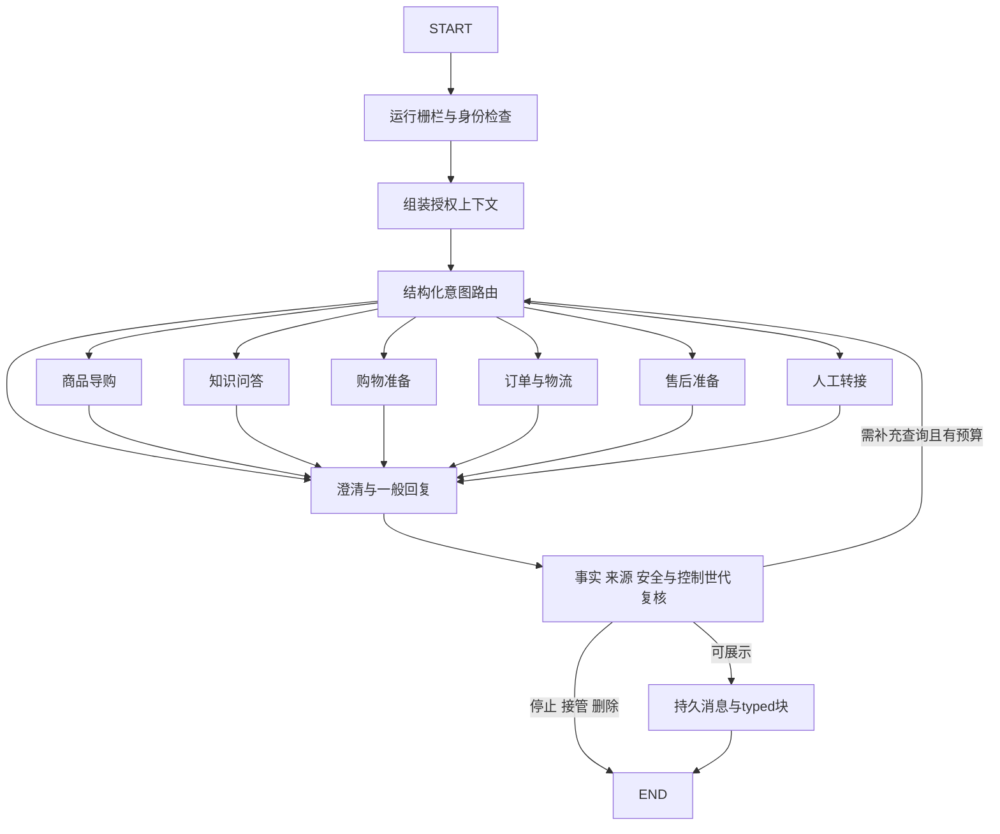

# LangGraph与工具编排设计

版本v0.2。本文覆盖导购、知识、购物、订单、售后、人工转接、模型适配与多媒体理解；业务执行由独立确认服务和Java事务完成。

## 1 编排原则

采用一个受控入口和多个专项节点。专项节点可以包含局部子图，但共享同一个run、全局名额、总deadline、工具预算和停止信号；不能为每个节点再领取名额或并行创建多个自主agent。路由结果是结构化意图，不是执行授权。

图只持久化可安全恢复的业务引用和非秘密上下文。动作卡片、消息、接待和知识活动状态以领域表为准，检查点是编排内部记录，不能作为订单事实或绕过访问控制的凭证。

普通模型失败保留用户消息与人工入口；多媒体、重排或检索故障按能力降级。无法验证的商品事实、订单结果、服务承诺和来源不进入最终回答。

## 2 图结构

所有进入专项节点的边均先执行Guard。N11允许最多一次有界补充查询；补充后仍缺依据则输出澄清/未知，不形成无限路由循环。N12写入前再次检查run、lease、control_epoch和memory_epoch。

## 3 GraphState与运行上下文

### 3.1 可以检查点化的字段

| 字段 | 类型建议 | 来源与规则 |
|---|---|---|
| schema_version | 固定字符串 | 首版agent-state-v1；升级需要兼容器 |
| conversation_id、run_id、trigger_message_id | UUID | 服务端创建，不接受模型覆盖 |
| member_id | Java ID字符串 | 经Java验证；恢复仍需重新授权 |
| control_epoch、memory_epoch | 正整数 | 从会话快照取得，任何续接先核验 |
| graph_version | 字符串 | 构建版本/提交，不与提示词版本混用 |
| intent | 枚举 | GUIDE、KNOWLEDGE、SHOPPING、ORDER、RETURN、HANDOFF、CLARIFY、GENERAL |
| workflow_step | 枚举 | 澄清/查询/选对象/准备/回答；不包含执行订单 |
| selected_product_ids、selected_sku_ids | ID数组 | 工具查询确认过的候选；后续仍复核 |
| selected_order_id、selected_order_item_id | 可空ID | 本人订单；多匹配必须让用户选 |
| action_ids | UUID数组 | 已存在action引用，不保存执行授权 |
| source_refs | 文档/版本/切片ID数组 | 附必要出处；新回答复核活动状态 |
| visible_context | 已过滤消息摘要与有限工具事实 | 不保存内部备注、秘密或完整地址 |
| config_snapshot | 非秘密JSON | 模型配置版本、prompt_id、限额和适配器版本 |
| steps_used、tool_calls_used | 整数 | 所有专项节点共享累加 |
| started_at、deadline_at | RFC3339 | 不能通过恢复重置总时限 |
| outcome、safe_error_code | 枚举/字符串 | 可映射到稳定用户状态 |

visible_context只保留必要轮次和工具摘要，不能复制无界原始消息列表。模型工具调用ID属于供应商运行细节，必须绑定当前run；恢复后不能凭旧工具ID重复执行动作。

### 3.2 只能存在于运行上下文的字段

会员/员工令牌、Authorization头、服务密钥、secret字节、confirm receipt、核对receipt、HTTPX连接、数据库session、cancel token、broker句柄、完整原始媒体都不进入GraphState。供应商请求携带的system prompt可以受控使用，但普通日志和买家响应不返回其全文。

用户身份验证到期后，已有消息保留，run终止为INTERRUPTED/AUTH_EXPIRED。重新登录后的重试重新构造当前可信上下文，不把旧检查点中的member_id当作授权。

### 3.3 上下文装配顺序

1. 读取当前会话、状态、control_epoch、memory_epoch及可见消息边界。
2. 读取仍未到期、未删除的最近消息；人工内部备注永不参与。
3. 选择与memory_epoch一致、through_seq合理且未过期的总结，删除后旧总结拒绝使用。
4. 将商品/订单入口ID重新交Java验证，得到当前业务摘要。
5. 读取固定模型配置和节点提示词版本，保留模型token预算。
6. 附件由M10校验归属后提供有限识别结果；识别文本标为不可信输入。
7. 工具事实保留checked_at和来源类型，已经过时的价格与订单状态按需重查。

## 4 节点详细设计

| 节点 | 输入 | 处理与输出 | 失败和停止 |
|---|---|---|---|
| N01 运行检查 | run引用、当前租约 | 检查身份、活动run、世代、停止、deadline和预算 | 失败不调用模型；落明确中断码 |
| N02 上下文 | 消息、入口ID、总结引用 | 授权过滤、裁剪与非秘密配置快照 | 缺消息/旧epoch终止；缺业务对象提示失效 |
| N03 路由 | 当前问题、有限上下文 | 结构化intent、置信依据、缺失槽位 | 输出不合法重试最多1次，再澄清 |
| N04 导购 | 用途、预算、品牌、分类、规格 | 查询真实商品、澄清、比较facts和推荐理由 | 无匹配不放宽预算；缺字段标未提供 |
| N05 知识 | 问题和可见范围 | 检索有效版本、来源、冲突与证据置信 | 无依据/冲突说明未知；不编政策 |
| N06 购物 | 商品/SKU/数量/地址优惠 | 收集参数、查选项、调用准备工具生成action | 缺SKU/地址需用户选；不confirm |
| N07 订单 | 订单号或近期上下文 | 查本人订单、物流、准备取消卡 | 多订单选择；已付款不准备取消 |
| N08 售后 | 订单明细、原因、数量、凭证 | 查规则/资格、准备申请卡 | 超期、数量不足、历史歧义转人工 |
| N09 转人工 | 明确人工请求或无法解决场景 | 发起排队请求，展示等待与继续AI选项 | 未明确请求可建议按钮；不假称已接待 |
| N10 回复组织 | 结构化事实、来源、action引用 | 生成可见文本，附typed商品/订单/操作块 | 业务成功取服务结果，不取模型措辞 |
| N11 输出复核 | 草稿、来源版本、运行状态 | 过滤敏感字段/危险HTML，复核事实和活动来源 | 停用来源丢弃对应段；停止后不再输出 |
| N12 提交终态 | 已验证可见内容 | PG写完整message、run终态、completed事件 | 事务失败可读已有部分，不虚构completed |

### 4.1 导购槽位与比较

槽位包括预算上限/下限、用途、品类、品牌偏好、必须规格和可放宽条件。用户明确“3000元以内”必须向Java传max_price=3000.00；无结果时提示用户选择放宽，不能自动改为3500元。

候选商品只由工具返回，模型不能追加未出现的商品ID。对比表按共同facts和SKU属性构造，不把营销文案推断为硬件事实。商品卡价格和库存为查询快照，加入购物车/创建订单前再次校验。

### 4.2 购物准备

DIRECT收集items，CART收集已有cart_item_ids，两者互斥。地址只选现有address_id；无地址时给现有地址页入口。选优惠或积分后重新报价，quote中分项和总额均由Java计算。

prepare工具返回action引用后，模型只能解释该卡片。用户发送“好的”“确认”“帮我付款”不触发confirm；自然语言只能引导点击。新的数量/规格生成新action并使旧卡失效，不能就地修改确认过的parameters。

2026-11-14实施边界：成功接收任意新会员消息的事务先使未确认旧卡STALE，再安排下一run；无需等待模型生成替代卡。发送界面说明此行为。消息重放不再次失效新卡，EXECUTING/UNKNOWN继续原编号核对；准备请求重放返回原卡当前状态。地址/券/积分采用仍可见会员明确表达，否定和未解决冲突不授权，明确修改取最终值。见[38](../38-多轮选择与四类确认卡更新验收.md)。

### 4.3 订单与售后

订单号也不跳过归属。近期多单用订单选择块，禁止凭相似商品猜订单。模拟物流必须附is_simulated；无节点明确未维护，不生成预计送达日。

售后先定位order_item_id，再读remaining_quantity、time_window和金额规则；图片凭证先经M10保护。AI只准备和查询，人工review/receive/simulate-refund永远不在工具白名单中。收到退货、批准和模拟退款是不同事实。

### 4.4 转人工

用户明确要求人工时可以由T10创建客服排队记录，这是客服状态命令，不是商城订单执行。模型自行判断无法回答时可以建议人工按钮；用户尚未表达同意时不自动创建无意义队列。WAITING_HUMAN默认停止自动AI，用户显式启用waiting-ai-mode后才继续。

人工接管后图在下一Guard或持久输出检查被拒绝。供应商可能仍产生/计费token，界面不得展示旧run的新内容。正在执行的Java操作独立核对，不能因接管假称取消。

## 5 工具注册表

| 工具 | 允许节点 | 参数 | 服务与外部接口 | 返回与限制 |
|---|---|---|---|---|
| T01 search_products | N04 N06 | query、分类/品牌、预算、cursor | M05 → bridgeProducts | 已上架商品；真实预算过滤 |
| T02 get_product | N04 N06 | product_id | M05 → bridgeProductDetail | SKU与facts；不接受模型价格 |
| T03 list_orders | N07 N08 | order_sn或近期cursor | M05 → bridgeOrders | 只查当前会员 |
| T04 get_order | N07 N08 | order_id | M05 → bridgeOrder | 明细、状态、金额、售后摘要 |
| T05 get_logistics | N07 | order_id | M05 → bridgeLogistics | 模拟标记与真实维护节点 |
| T06 get_return_eligibility | N08 | order_id、order_item_id | M05 → bridgeReturnEligibility | 数量、规则和分摊结果 |
| T07 get_checkout_options | N06 | 已选DIRECT/CART参数 | M05 → bridgeCheckoutOptions | 已有地址、优惠和积分，不写业务 |
| T08 retrieve_knowledge | N04 N05 N08 | query、已授权scope | M09检索和来源复核 | 来源标识由系统生成 |
| T09 prepare_business_action | N06 N07 N08 | 四种ActionParameters之一 | M06 → bridgeQuote | 仅准备；返回不可变Action |
| T10 request_human | N09 | reason、conversation引用 | M07 → requestHandoff同一领域服务 | 只变客服状态，不代表已有人接待 |
| T11 get_cart | N06 | limit≤20、after | M05 → bridgeCart | 当前会员购物车只读快照、可用性、游标；不返回会员编号，不能替代结算报价 |

2026-11-13补齐：CART选项读取前必须取得本轮确切条目，DIRECT与加购绑定商品/SKU及可用数量；订单准备绑定相同购买方式、商品、规格与数量的选项，地址/优惠券/积分均校验可选范围。取消须读确切ORDER详情，退货须读确切ELIGIBILITY明细、数量与原因。只读来源绑定不等于用户已选择，也不代替最终点击确认。

不存在通用HTTP、shell、SQL、支付、退货审核、直接create_order/confirm_action工具。工具说明中的禁止语句是辅助，实际注册表与服务授权才是执行边界。

### 5.1 执行器统一步骤

校验工具名和节点白名单 → Pydantic严格类型与字段白名单 → Guard校验当前run和预算 → 从RuntimeContext补入主体 → 解析固定服务目的地 → 有界IO → 检查HTTP和Java业务码 → 校验返回Schema与归属 → 脱敏并生成ToolResult → 记录调用耗时/类别。

每次工具调用前重新检查控制世代和租约；在途查询返回后再检查一次，接管后的结果不得进入新消息。参数中出现model传入member_id、token、url、sql等未定义字段直接拒绝，不静默忽略。

### 5.2 错误约定

| 错误 | 图处理 |
|---|---|
| AUTH_EXPIRED / PERMISSION_DENIED | 中止当前任务，引导认证或说明不可访问 |
| RESOURCE_NOT_FOUND | 说明对象不可用，不区分他人对象与不存在 |
| NO_MATCHING_PRODUCTS | 保留原筛选条件，询问用户是否放宽 |
| KNOWLEDGE_NO_EVIDENCE / SOURCE_CONFLICT | 说明未知或冲突，附可验证来源/人工入口 |
| QUOTE_CHANGED / STOCK_INSUFFICIENT | 原卡失效，重新准备并要求用户再次点击 |
| RATE_LIMITED / QUOTA_EXCEEDED | 保存消息与已有文本，提示稍后或人工 |
| DEPENDENCY_UNAVAILABLE | 有限查询重试，失败后说明无法核实 |
| RUN_FENCED / CONTROL_EPOCH_CHANGED | 静默停止旧生成写入，界面以最新状态为准 |

## 6 运行限额

下列为首版建议默认值，部署时进入类型化配置并记录版本；不是对供应商时延或费用的保证。

| 项目 | 建议值 | 超限行为 |
|---|---|---|
| 同时活动run | 全局3、每会话1 | 第4个QUEUED，可取消 |
| 单run墙钟时长 | 180秒 | 请求停止，保留已接收内容 |
| 图步数 | 16 | GRAPH_STEP_LIMIT，说明未完成 |
| 工具总次数 | 12 | TOOL_BUDGET_EXCEEDED，不新增动作 |
| 相同工具相同参数连续调用 | 最多2次 | 第二次后必须变策略或结束 |
| 路由结构修复 | 最多1次 | 仍失败则澄清，不默认走交易 |
| 查询重试 | 最多2次且在总deadline内 | 指数退避，429遵循Retry-After |
| 单次模型输出 | 不超过配置max_output_tokens | 有限停止；不能生成无界回答 |
| 知识召回 | 初召回20、重排8、供回答最多5父块 | 可调且受总token预算约束 |
| 上下文 | 建议最近20条+有效总结 | 优先保留当前问题与权威事实 |

同一run多个节点的LLM请求顺序执行，共用一个生成名额；知识重排/向量化是辅助能力并有独立并发上限。后台构建不能抢占全部对话请求连接和费用额度。

## 7 流式输出与控制屏蔽

路由JSON、内部思考、工具参数和原始错误都不作为message.delta。只有已筛选的可见文本进入用户流。对于需要最终来源复核的政策句，先缓冲相关段落，N11复核后再提交；不能先输出不可靠政策，再寄希望最终消息纠正。

每个message.delta带message_id、run_id、offset和control_epoch；offset按Unicode码点计数。客户端使用Array.from(text)或等价码点实现处理，测试必须含中文和emoji。遇到重复offset忽略已接收部分，遇到缺口读取快照/完整消息，不直接拼接错位文本。

控制消息先更新客户端当前control_epoch；旧epoch delta丢弃。新消息或改名只提高对象version时不能误清已有run。持久化时同样执行栅栏，不能仅在浏览器过滤。

## 8 检查点与恢复

checkpoint thread_id建议为conversation_id:memory_epoch:run_id。conversation_id不单独作为可被前端任意指定的恢复键；每次恢复先通过M01/M02验证归属、epoch、内容仍存在和当前状态。

AsyncPostgresSaver使用独立langgraph_checkpoint schema和独立连接池；组件setup与迁移版本锁定后执行，不手工修改框架内部表。检查点必须纳入备份与删除，依赖升级在隔离库验证旧状态兼容。

首版恢复策略：未开始的QUEUED在可重新建立身份时可运行；已开始而丢失worker/内存凭据的run标INTERRUPTED，已接收消息和部分答案可读。用户决定retry后创建新attempt；旧action引用可查询，但不重新执行、确认或自动准备相同写操作。后续若增加自动续写，仅允许明确幂等的读节点，并单独验收。

## 9 知识处理与检索内部流程

### 9.1 解析与构建

1. 校验20MB、页数、格式和原件归属，创建版本与附件引用。
2. pypdf提取文本层；DOCX提取段落/表格和标题路径；TXT校验编码。扫描PDF无法提取时显示需补文本，不静默成功。
3. 保存parsed_text、警告、页码/章节和内容哈希，供员工预览校正。
4. 按标题切父块、按长度切子块。建议子块500–800字符、重叠50–100字符，最终通过题集调参。
5. 固定embedding配置版本，记录dimension与collection generation，分批向量化并幂等写入。
6. 质检非空、切片数量、父子关系、元数据和测试问题；成功READY，失败保留旧活动版本。
7. 有权员工发布，PG原子切active_version_id；旧索引异步回收但仍按引用保护原文。

### 9.2 检索流程

query规范化 → 授权scope → 候选活动集合 → query embedding → 子块召回 → PG复核版本和权限 → 父块去重补上下文 → 重排 → 证据选择与冲突识别 → 受约束回答 → 输出前复核来源。

embedding服务不可用时，已有普通业务查询和人工仍可用。首版不宣称存在未设计的BM25替代检索；如增加关键词降级需要实现并记录其适用范围。rerank不可用可在明确标记降级下使用原召回排序，但仍保留证据不足判断，不把重排失败当有据答案。

### 9.3 向量元数据

| 字段 | 作用 |
|---|---|
| chunk_id、parent_chunk_id | PG权威切片引用 |
| document_id、version_id | 版本与启停复核 |
| visibility、product_ids、category_ids | 初步授权与业务范围过滤 |
| embedding_profile_id、profile_version、dimension | 集合和模型兼容 |
| generation、content_sha256 | 重建与幂等写入 |
| text、vector | 派生检索内容；原文仍在PG/MinIO |

## 10 模型适配契约

| 能力 | 内部接口 | 输入 | 输出与必须验证 |
|---|---|---|---|
| DIALOG | stream_response、continue_with_tool_results | 安全消息、固定工具Schema、版本化配置 | 可见delta、tool call、完成、usage和provider_request_id |
| EMBEDDING | embed_documents、embed_query | 经校验文本批次、dimension | 与目标维度一致的向量、调用量 |
| RERANK | rerank | query+已授权候选 | 有界索引和分值，不新增候选 |
| VISION | understand_images | 私有受控字节和问题 | 线索文本；不推定付款/订单事实 |
| ASR | transcribe | 受控音频、格式与语言 | 可编辑转写、时长、错误 |
| TTS | synthesize | 安全可见文本、受控音色 | 有界音频字节、格式、时长 |

对话模型保留gpt-6.1-sol，其他候选模型沿用需求文档。实际端点分别注册、独立验证；官方页面未可访问或账户未开通时，记录“待验证”，不填造可用性和价格。provider SDK与langchain包装的差异隐藏在adapter中，领域服务只依赖内部协议。

| 能力 | 原需求候选 | 固定前必须验证 |
|---|---|---|
| DIALOG | gpt-6.1-sol | 独立应用端点、Responses流式、工具调用与结构化输出 |
| EMBEDDING | 阿里云text-embedding-v4，拟1024维 | 账户/地域、实际dimension、批大小与计量 |
| RERANK | 阿里云qwen3-rerank | 返回索引范围、分数与最大候选长度 |
| VISION | 阿里云qwen3-vl-plus | 私有字节上传方式、多图/像素/token限额 |
| ASR | 阿里云qwen3-asr-flash | 中文短录音、格式、时长与可编辑结果 |
| TTS | 阿里云qwen-audio-3.1-tts-flash | 音色、输出格式/长度、取消与计量 |

这些名称保持原需求候选，不等于已经接入成功。当前Codex会话配置只能说明用户选型意图，商城运行时必须使用自己的独立受控服务接入配置，不能复用或读取其他Codex会话。

兼容题包括纯文本、多轮工具、分片tool arguments、同轮多个tool call、结构化输出、超时、429、取消、usage缺失、UTF8分片和error终态。工具参数未拼接完成前不得执行。供应商只支持其他协议时先评估适配并更新证据，不静默改需求模型。

## 11 提示词与评测

2026-11-13实施补充：实时业务展示采用对象/字段绑定的事实目录，模型逐条选择已有编号，服务端渲染确切字段或政策原文，不接受自由改写字段值。完整JSON对象生成即可输出，无需等待换行。政策引用先持久绑定，正文事务再次复核来源；中断后保留引用并在历史标记失效。纯知识路径检索后直接选择原文，N04/N08也开放受控T08。fact-selector提示词进入不可变版本和run快照/调用账本，详见25号实施记录。

累计需求摘要改为按源消息序号增量推进，保存来源ID、hash、主题及世代；逐次复核可见性/期限。早期重要需求优先保留，后续明确修改覆盖同主题；摘要有32片段/约4800字符预算，200消息一批、单次最多2000消息，未完成扫描明确标记，不能当完整无限记忆。价格、政策、权限和执行确认仍须当前权威来源。

| prompt_key | 职责 | 不可覆盖的服务端约束 |
|---|---|---|
| route | 意图与缺失槽位 | 不授予身份或工具权 |
| guide | 预算内商品比较 | 商品事实必须来自工具 |
| knowledge | 有据规则回答 | 只能引用授权活动来源 |
| shopping | 收集购物参数 | 不调用确认或付款 |
| orders | 本人订单与模拟物流 | 不猜归属或配送承诺 |
| aftersales | 明细申请与解释 | 不批准或退款 |
| answer | 可见文本组织 | 不暴露内部信息或宣称未验证成功 |

提示词草稿/发布/恢复均有独立权限和审计。已发布内容不可编辑；恢复旧版本是重新设置活动版本，不覆盖历史。上线评测保留预算不足、缺参数、无知识、冲突、恶意文档、越权订单、假付款截图和“直接确认”指令等题集。

评测按事实、来源、业务结果和授权边界评分，措辞可变化。发生一次越权或重复业务副作用，对应验收失败；不能用平均回答满意度掩盖。模拟provider仅用于确定流程测试，页面必须标测试模式，不能记为真实模型接入通过。
