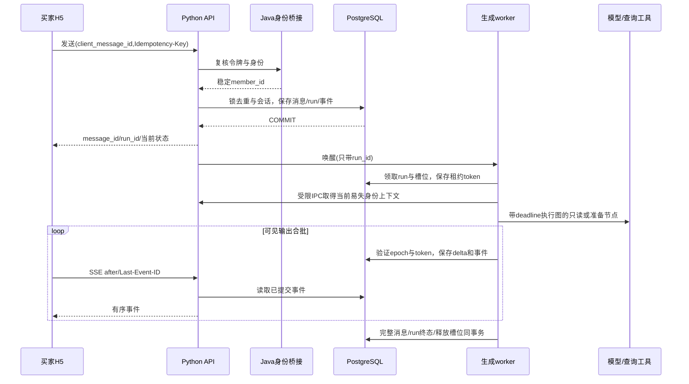
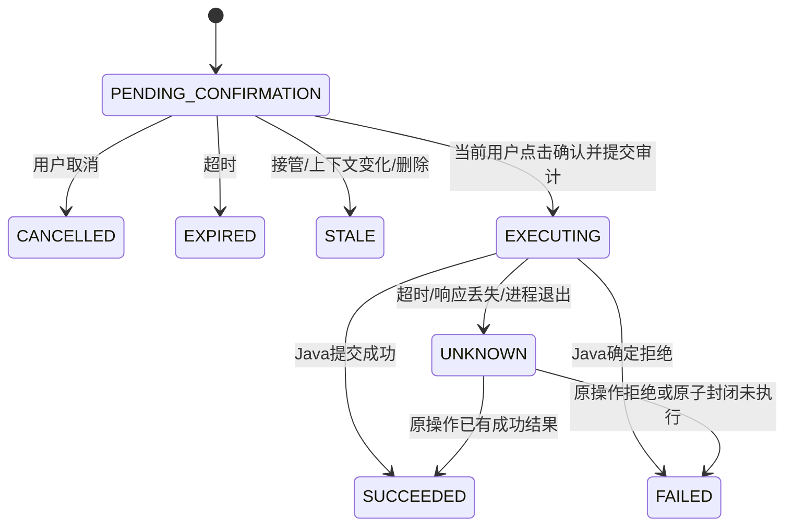
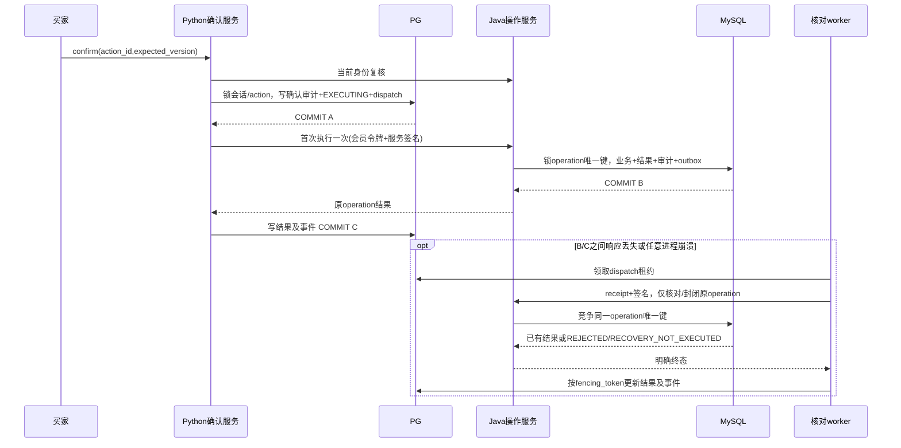

# 智能体关键流程与故障恢复

架构 v0.2，2026-11-11。本文规定实现必须保持的不变量、事务边界和异常结果。SQL、伪代码及时间值用于设计说明，尚未在目标数据库运行。对象字段以 database/ 和 api/ 的契约为准；本分册解释跨模块语义。

## 1 全局不变量

| 编号 | 必须成立的规则 | 执行位置 |
|---|---|---|
| I01 | 身份来自 Java 当前令牌校验，任何对象先查归属再返回内容 | M01、M17及所有领域入口 |
| I02 | 消息接收成功意味着消息、run和必要事件已经提交 | M03一个PG事务 |
| I03 | 同会话最多一个活动run，全局最多三个生成名额 | PG约束、ag_generation_slot、租约与栅栏 |
| I04 | 模型只能查询和准备；业务执行必须有用户真实确认审计 | M04工具白名单、M06、Java执行入口 |
| I05 | 同operation_no最多一次业务副作用，核对不产生业务副作用 | MySQL唯一操作主键和同事务结果 |
| I06 | 未知结果不能报告成功或失败，未确认内容不能自动恢复执行 | Action状态机、dispatch恢复器 |
| I07 | 人工接管、停止、关闭、删除后旧生成不能继续提交可见内容 | control_epoch、run状态、租约token |
| I08 | 已发给前端的持久事件游标不会越过以后才提交的更小事件 | ag_event_clock提交有序协议 |
| I09 | 规则答案只引用当前授权且活动的知识版本 | 检索复核、输出复核、引用读取 |
| I10 | 订单实付、取消资源和退货金额最终由Java精确计算 | M18/M19共享领域服务 |
| I11 | 普通聊天到期不能删除仍受保护的业务凭证和审计 | M10/M12及Java保护引用 |
| I12 | 每次模型调用绑定不可变配置版本，未知计费用量不得伪造为零 | M11/M13及额度预留账本 |

## 2 锁序与事务约定

### 2.1 PostgreSQL

所有流程遵循同一层次：请求去重占位 → 员工资料行（按admin_id排序）→ 会话行（按UUID排序）→ 接待/run/action/附件及引用等领域行（同类按主键排序）→ 生成槽位 → 审计等新行 → 事件时钟。需要其他域锁的流程必须在获得事件时钟之前取得。领取同时锁目标员工与会话；转交先按ID顺序锁原员工和目标员工，再锁会话。

事件时钟必须是最后取得的共享竞争锁。取得时钟后，仅分配ID、插入已准备好的事件、更新已锁行及提交；禁止再查带锁业务行、请求Java、调用模型、上传文件或等待MQ。涉及外键的目标行和业务验证须预先准备，避免事件插入隐含获取新的业务锁。实现评审必须检查真实SQL锁图，不能只看方法调用顺序。

领取生成槽位采用短事务：先锁run所属会话/run，再尝试空闲槽位；无槽位则不持锁等待，释放并稍后扫描。不要先持槽位再等会话。任务队列可以用SKIP LOCKED，但只用于不要求严格全局FIFO的待执行选择。

遇到死锁/序列化冲突，整个本地事务回滚；仅对尚未外调的幂等本地事务有限重试。外部业务调用之后的超时不能靠重跑整个HTTP处理器解决。建议业务锁等待2秒、短事务5秒为初始值，实际值在并发试验后固定。

### 2.2 MySQL

交易入口先校验签名、身份和参数，再进入事务：operation唯一键 → 会员资源/订单 → 优惠券 → 积分记录 → SKU按ID排序 → 购物车/订单明细/售后记录 → 审计/outbox。所有新增入口与旧下单、支付、取消入口必须统一资源锁顺序；改造前根据现有调用链确认最终顺序并测试。只有新桥接遵守而旧流程相反仍可能死锁。

员工写使用 request_dedupe唯一键在前，随后相同业务锁顺序。幂等记录、业务更新、审计和需投递的outbox同一事务。外部模型、PG、MinIO及RabbitMQ不参与MySQL事务。数据库之间采用持久状态核对，没有跨库两阶段提交。

## 3 消息接收、生成与停止



接收事务在HUMAN模式只保存买家消息并通知客服，不创建AI run。WAITING模式按waiting_ai_mode决定是否创建；无人在线也保留排队事实。处于关闭/已删除状态拒绝发送，不能偷偷恢复旧接待。

去重键作用域为主体类型、主体ID、operationId、Idempotency-Key；消息另有conversation_id+client_message_id唯一约束。比较规范化后的业务body哈希，排除request_id等传输字段。同键不同内容返回409；同内容返回原对象的当前状态。去重记录到期后仍由业务唯一键防重复，不能把去重表TTL当唯一保障。

生成状态以契约枚举为准：QUEUED → RUNNING → COMPLETED；失败为FAILED，用户停止为STOPPED，进程/身份丢失为INTERRUPTED。终态不能回到RUNNING；retry创建新attempt和run，引用原用户消息。是否已经完成的判断使用数据库，不能凭收到一个SSE关闭事件。

停止事务锁会话与run，更新STOP_REQUESTED、递增控制世代、写停止事件；提交后发取消信号。旧worker即使未收到信号也因epoch/token检查无法提交。确认供应商请求终止或到达保守deadline后才标STOPPED并释放槽位，不能点击停止就立即用同一名额发第4个模型请求。已付出的调用费用保留记录；停止不撤销已完成业务，也不将EXECUTING操作改为已取消。文本缓冲建议最多200毫秒或64个Unicode码点合批，最终值通过首字延迟和PG写负载测试确定。

身份令牌只在API内存凭据代理短时存在。worker通过仅本机可达且带服务身份的IPC读取与run租约绑定的上下文；禁止传入模型、数据库、Redis、MQ或checkpoint。API重启、令牌失效、排队过久且无法重新验证时，标记AUTH_CONTEXT_LOST/INTERRUPTED，请用户登录后重试，不由worker使用旧Principal继续业务查询。

## 4 SSE补传与一致快照

### 4.1 为什么需要提交有序时钟

反例：事务A通过sequence取得101但尚未提交，B取得102并先提交，客户端收到102后记录游标；A以后提交101，使用after=102将永久漏掉101。轮询窗口和Redis通知不能可靠修复这个问题。

本设计所有可见事件都遵守以下协议：

```text
BEGIN
  取得该用例全部业务锁；完成授权、状态和版本核对
  执行业务写入，准备本事务的N个事件内容
  SELECT last_event_id,replay_floor FROM ag_event_clock
    WHERE singleton_id=1 FOR UPDATE
  为N个事件显式分配 last_event_id+1 ... last_event_id+N
  更新时钟并插入事件；不再取得新的业务锁
COMMIT
```

时钟更新与事件回滚会一起回滚，不使用nextval。B要取得时钟就必须等待A提交或回滚，因此不能发布一个越过尚未提交较小ID的游标。这是当前演示规模下接受的短暂全局串行点；新增实例也必须共用同一时钟。高吞吐扩展需重新设计提交日志，不能自行移除锁。

### 4.2 快照

getConversation/adminConversationSnapshot在同一个REPEATABLE READ只读事务中读取会话、最近20条可见消息（包括生成中正文）、run/action/接待/已读状态及ag_event_clock.last_event_id，分别返回recent_messages、active_run、pending_actions、handoff、read_position和event_cursor；history_cursor继续读取更早历史。先建立该事务快照，再读取全部对象；不能先读取消息、事务结束后另查最大ID。

客户端以快照替换本会话状态，再订阅after=event_cursor。快照以前已提交的事件效果已包含；以后提交的事件ID大于该值。event_cursor是全局高水位，该会话仅接收自己授权范围内的事件。

员工工作台首次读取ConversationPage、HandoffPage和需要展示的JobPage；每个列表将本页对象与event_cursor在同一RR快照中读取。客户端从这些水位的最小值订阅adminEvents，按对象version/消息seq归并重放，低版本事件不覆盖较新快照。翻页期间updated_at排序对象可能移动，前端按ID去重并刷新，普通列表游标不承诺跨多次请求的冻结快照。发生410时重读这些列表与当前会话快照，不能仅重读聊天窗口而漏掉排队归属变化。

### 4.3 补传与客户端归并

| 情况 | 服务端 | 客户端 |
|---|---|---|
| 首次进入/刷新 | 鉴权快照，再从高水位订阅 | 以对象ID和消息seq构建状态 |
| 短暂断线 | 按after升序读取持久事件 | 以event_id去重，再更新本地游标 |
| after小于replay_floor | HTTP410 EVENT_CURSOR_EXPIRED | 重读快照，不能从最新游标直接续接 |
| after大于当前last_event_id | 拒绝无效游标，提示重同步 | 不反向猜测事件 |
| 重复delta/重复事件 | 允许至少一次传输 | event_id去重，offset检查重叠 |
| delta存在offset缺口 | 完整消息接口仍可读 | 重新读消息/快照，停止错误拼接 |
| 接管/停止后旧delta | 数据库写入已拦截，缓冲网络仍可能到达 | 丢弃旧control_epoch/run_id |
| 会员注销/员工失权 | 建连和每30秒复核；业务事件逐条授权 | 断流并清理不再授权的页面状态 |

读取查询为event_id>after ORDER BY event_id，先按可见范围过滤，再逐条复核对象权限。全局间隙可以是其他会话事件，不要求客户端等缺失整数。员工订阅必须按当前可读会话集合、权限和事件类型投影；同事内部备注不能混入买家流。不能把原始outbox JSON直接转发。

MessageAccepted.event_cursor仅用于定位本次提交。已有订阅只能在事件实际应用成功后推进消费游标，不能收到较新的POST响应就直接跳过尚未消费的旧事件。消息已读last_seq与SSE消费event_id分别保存；历史分页按消息seq，控制变化按对象version/control_epoch归并。

Redis只发送“有新事件”的提示。丢失提示、订阅重建或Redis故障时，SSE仍可定期查询PG；每个连接不长期占用一个PG事务或连接。建议15秒注释心跳、1秒数据库兜底轮询；网关禁用响应缓存和缓冲，空闲超时大于心跳间隔。

事件清理只能删除已过期的连续全局前缀。先按事件时间确定可安全删除的前缀上界，在同事务更新replay_floor并删除该前缀；有长保留事件阻挡时暂不跨越删除后续行。买家删除不依赖马上物理删除事件，而是先阻止授权读取；清理副本内容仍进入后续擦除任务。不要在游标中放令牌，URL中的after只含事件编号。

## 5 操作准备、确认与结果核对

### 5.1 Action状态



上图使用Action契约的精确枚举；Java BusinessResult.REJECTED映射Action.FAILED，NOT_COMMITTED映射UNKNOWN，不能混用两套状态。页面对UNKNOWN显示“核对中”；ag_action_dispatch的MANUAL_REQUIRED表示自动核对遇到凭据过期/长期依赖故障需处理，不伪造Action已失败。终态不可再执行。准备参数改变、价格变化、确认卡过期都生成新action；不能编辑已确认快照。

准备入口重新查询Java，固定action_type、member、参数、报价、参数哈希、有效期、control_epoch。准备加车也需实际SKU核验。Java报价本身不锁库存、优惠券或积分；确认前卡片不是资源承诺。图节点可以准备，不能调用confirm。

### 5.2 确认的三个提交边界



COMMIT A之前同时生成仅核对凭据并加密保存。确认请求的首次发送者使用本次有效会员令牌，提交A后最多尝试一次execute。禁止HTTP客户端对execute自动重试。即便Java执行有幂等保障，恢复策略仍仅核对，以免在用户登录失效或环境改变后重新启动业务。

### 5.3 原子封闭缺失操作

只查一次返回404无法证明业务失败：原execute可能仍在事务内。reconcile的FINALIZE_IF_ABSENT先验证receipt绑定参数与原编号，然后尝试插入同一个oms_agent_operation主键。若执行事务持锁则等待其提交/回滚；提交后读取原结果，回滚后核对事务可写入REJECTED、error_code=RECOVERY_NOT_EXECUTED。

核对先插入成功时，之后迟到的execute必须先读到该拒绝终态并直接返回，不能再运行领域逻辑。核对不会调用下单、加车、取消或退货方法。锁等待超时、数据库不可达、读取不确定均仍为UNKNOWN，绝不能将这些异常转换成“无记录”。QUERY_ONLY只读已有结果，缺失仍需后续核对。

receipt由可信内部密钥签发，绑定purpose=reconcile_only、audience、operation_no、member_id、action_type、parameters_hash、confirmed_at、confirmation_audit_id、issued_at、expires_at、key_id；建议最长7天并可通过当前用户重新认证续签原操作。confirmed_at用于原子封闭行的非空确认时间，不能取核对时刻冒充确认。密钥与普通业务签名分离。凭据不能改变参数、代表用户确认、授权execute、查询其他operation或读取完整个人资料。续签只延长核对用途，保留原确认审计。

| 故障窗口 | 数据事实 | 恢复规则 |
|---|---|---|
| A之前崩溃 | 未确认、无dispatch | 原卡仍待确认或过期，没有业务执行 |
| A之后execute之前崩溃 | 已确认但业务可能未开始 | 核对后可原子封闭未执行，提示重新准备 |
| Java事务未提交进程退出 | MySQL回滚或仍在途 | 竞争操作锁，确定回滚后封闭 |
| B之后响应丢失 | Java结果已持久化 | 返回原结果，不执行第二次 |
| A成功但PG暂不可用 | Java可能完成、C未写 | PG恢复后dispatch扫描与Java核对 |
| worker重复投递 | 同一action不同核对尝试 | 租约token限制PG写，Java原编号锁去重 |
| receipt过期/旧密钥不可用 | 业务结果仍可能存在 | MANUAL_REQUIRED，当前用户重新认证续签/受限运维核验 |
| Java明确拒绝原核对凭据 | 业务结果仍可能存在，不能当作未执行 | UNKNOWN及MANUAL_REQUIRED，停止自动重发无效凭据；员工续签复核原操作编号、确认时间、审计/hash/epoch，仅重新授予原编号核对权限 |
| Java持续不可用 | 无法判定 | 有限退避、告警、保留UNKNOWN与确认记录 |
| 接管/删除发生在执行中 | 已确认业务不能假撤回 | 继续核对；买家不可见内容按权限隐藏，业务记录保护 |

建议核对退避2、5、15、30、60秒，其后最多每5分钟；超过10分钟显示延迟告警，1小时进入人工关注，状态不因时间自动成功或失败。具体阈值配置化。用户重新prepare之前必须先展示原未知操作，避免误以为没成功而产生第二个合法新订单。

## 6 签名、参数哈希与幂等

### 6.1 服务签名

固定签名串为METHOD大写、规范path+query、原始请求体字节SHA256小写十六进制、UTC RFC3339 timestamp、nonce五行，以LF连接，无末尾换行。timestamp使用固定毫秒精度yyyy-MM-ddTHH:mm:ss.SSSZ，并按收到的同一字符串验签，不改成epoch整数。空body按空字节哈希。path使用约定一次百分号编码，禁止代理二次解码；query按编码后的键和值排序，保留重复项，空格为%20。签名实现共用跨Java/Python的固定测试向量。

规范path采用OpenAPI登记的完整桥接路径。若gateway剥离mall-portal/mall-admin前缀，Java按服务固定配置恢复该前缀后验签，不信任外部传入的任意original-path头；代理改写必须纳入跨语言签名测试。

X-Agent-Signature格式为key_id:base64url(HMAC-SHA256)，base64url不含填充；key_id从服务白名单选择。比较用常量时间。时间偏差60秒，nonce按OpenAPI为随机UUIDv4，服务+key+nonce用Redis SET NX EX300防重放；Redis不可用时桥接拒绝，不能降为不验nonce。重试使用新nonce和签名、相同operation_no和幂等键。TLS或受限本机SSH隧道保护传输，HMAC本身不加密。

gateway剥离外部X-Agent-*、X-Operation-Receipt及伪造身份头，桥接只允许内部路由/可信来源。当前主体令牌同请求传递，Java仍验证角色与归属。仅reconcile这个明确标记的接口可采用BridgeSignature+OperationReceipt，其他22个桥接不允许“仅服务签名”。

### 6.2 业务参数规范化

业务参数哈希使用统一规范JSON：schema_version、action_type、member_id、参数对象；键按字典序，UTF-8，无额外空白；金额是规范两位小数字符串，ID为十进制字符串，数量为整数，枚举大写，缺省值先填充。不要对有业务顺序的数组排序；无序集合需在Schema中明确并按ID排序。自由文本保持原Unicode内容，不做会改变语义的隐式归一化。浮点数禁止进入金额字段。

Java从实际输入重新生成哈希并与quote/action/receipt对应值比较。浏览器提供的hash不作可信事实。哈希不包括Bearer、签名、时间戳、nonce或request_id。用中文、emoji、空值、DIRECT/CART、金额尾零、顺序差异建立共同样例；body原字节签名与业务规范哈希是两个用途。

## 7 报价、下单、取消与资源

统一Java计价结果包含SKU单价、数量、促销分摊、优惠券分摊、积分分摊、运费、应付金额、地址摘要、优惠选择、报价版本与过期时间。页面和AI卡片只使用该结构，不在Python重新计算优惠。

CART仅使用本人选中cart_item_ids且保存选择快照；DIRECT使用明确SKU+数量，不临时插入购物车。收货地址重新核验本人归属；模型不能创建或修改地址。选券/积分变化重新prepare。execute锁必要资源、再次计算，参数/金额/可用条件变化返回需要重新确认，不按新价格直接成交。

订单业务事务同时创建订单及明细、更新库存锁定、优惠券及积分、保存操作结果与审计。延迟取消任务由oms_agent_business_outbox持久化，不在事务提交前依赖一次MQ发送。publisher confirms成功后标记发送；重复发布由订单当前状态/业务event_key去重。

支付、取消、超时取消和人工取消共用OrderResourceService，以订单条件状态更新决定唯一赢家。胜出方才释放/扣减资源；不能先解锁库存再判断订单是否已支付。旧商城非智能体路径也需覆盖这组并发测试，桥接幂等不能替代旧入口资源一致性。

## 8 明细退货与人工阶段

### 8.1 资格和数量

必须用order_item_id定位明细并复核订单本人归属；同一product_id不等于同一SKU或同一成交价。历史申请无法唯一映射时标LEGACY_AMBIGUOUS，保留只读并人工处理，不猜映射。

有效占用数量为REQUESTED、APPROVED、GOODS_RECEIVED等未拒绝/未撤回申请的合计；退款完成数量也从剩余可退数量扣除。锁订单明细和有效申请后再次计算，保证累计不超过购买数量。默认7天窗口的具体起点、168小时含边界与时区按D03建议建立样例，在S2业务实现前固定；已发货未收货是否可申请也按需求原规则逐条验证，不自行扩充。

### 8.2 金额分摊

金额在Java以分或BigDecimal固定舍入处理。建议D04：优惠按明细原金额权重分摊，先向下取整，再把剩余分按余数从大到小分配，余数相同按稳定order_item_id排序；积分与券分别保留分摊来源。行净额再按数量拆分成稳定单件金额，前若干件承接余分。

例：总优惠1.00元，三行金额10、10、10元，分摊34、33、33分；不是每行都四舍五入33分而丢1分。行实付10.00元、3件，单件334、333、333分；累计退3件合计恰好1000分。多次申请按已退件位顺序分配剩余金额，不能每次都取得最高金额。运费是否退及上限按单独规则版本，不隐含纳入商品金额。

rule_version固定申请时规则，审核金额不能超过可退净额，拒绝必须有理由。并发申请、部分退款和重复simulateRefund均以数据库锁、唯一键和阶段条件处理，AI不能覆盖金额。

### 8.3 新旧状态兼容

| 新process_stage | 旧status | 操作主体/条件 |
|---|---|---|
| REQUESTED | 0待处理 | 买家确认提交 |
| APPROVED | 1退货中 | 有权员工审核通过，固定金额和退货地址 |
| GOODS_RECEIVED | 1退货中 | 有权员工确认收货；尚未模拟退款 |
| SIMULATED_REFUNDED | 2已完成 | 有权员工独立simulateRefund，记录模拟标识 |
| REJECTED | 3已拒绝 | 有权员工审核拒绝并留理由 |
| LEGACY/NULL | 保留旧值 | 旧数据只按兼容规则展示，不伪造新阶段 |

退货审核、收到货、模拟退款是三个明确的按钮与接口；不能审核通过就直接写已退款。退款是演示动作，不调用真实支付渠道。员工物流维护不改变订单状态；节点时间输入带时区、排序用occurred_at+id，编辑保留旧值与原因。

## 9 人工接待、权限与并发

申请转人工持久化handoff；同会话只允许一个有效排队/接待。领取事务先锁员工容量和会话，校验ONLINE/BUSY规则、权限、当前归属和expected_version，原子更新接待、control_epoch、旧run和待确认action。两个客服竞争仅一个成功，失败返回409后重新读取，不用前端乐观归属。

等待期间AI开关仅影响等待阶段；领取成功一律进入HUMAN，旧AI不可继续回答。旧action中PENDING失效，EXECUTING/UNKNOWN继续核对但不让客服重新确认。内部备注使用ag_staff_note和员工专用事件投影，完全排除模型上下文、买家快照和买家导出。

在线心跳建议20秒，租约建议60秒；超时显示离线，保留实际接待关系，不悄悄把会话交回AI。转交验证目标权限、在线状态及容量；关闭保留原因和历史，后续咨询按既定新会话/重新进入规则处理。管理员查看历史仍受明确权限审计，普通商品运营看不到客服内容。

业务摘要由当前会话绑定的member和相关order生成purpose限定访问grant，Java使用当前员工令牌+服务签名复核，不需要用户令牌。grant不能变成任意member查询入口。

## 10 知识发布、引用与模型版本

解析、分块、向量化分别有job进度与fencing_token，旧worker租约失效后不能把新任务写成READY。构建使用新version/generation和固定embedding_profile_version，分批upsert按chunk_id幂等；不先删除活动索引。中断可从已核验批次继续，失败保留旧版本。

发布锁document和待发布version，校验READY、质检、配置维度和expected_version，然后原子切active_version_id、更新状态、审计和事件。重复publish返回原结果。两个版本竞争仅一个按最新版本成功；停用与发布并发以同一document锁串行，发布不隐含重新启用。

检索结果进入模型前逐一从PG复核enabled、active_version_id、scope及块内容哈希；输出政策段前再复核。期间禁用或切版本，丢弃旧证据并重新检索一次，仍不足则说明未知/转人工。旧答案原文可保留，引用读取显示失效原因并按授权隐藏禁用原文。向量库只提供候选，不能作为授权最终来源。

配置保存同事务更新ag_model_profile并新增ag_model_profile_version；不可变快照包含真实model_name、端点注册版本、公开选项、秘密版本引用和兼容证据。调用绑定(profile_id,version_no)，切换活动配置不改正在运行的run。提示词版本、图版本和工具Schema版本进入run.config_snapshot；普通API不返回secret_version_ref。

配额调用前按UTC周期和能力/配置/主体桶，以确定排序的PG事务advisory lock完成所有桶预留，不能分别预留导致部分占用。跨版本共享额度桶，不因换配置清零。调用结果结算实际usage；缺失usage标UNKNOWN并保守占用。未发出请求可释放；请求发出后超时或取消不自动释放。TOKEN、SECOND、CHARACTER、REQUEST分开统计，估计人民币成本单独标注。

## 11 媒体、附件、删除与保护

上传验证身份、用途、扩展名、magic bytes、实际解码、字节数、像素或音频时长；文件名只用于显示，对象键由服务生成。图片解码/媒体转码运行在受限子进程，禁外部URL、外部引用和不受控解压。原始EXIF等个人信息按展示需求移除。对象上传成功但PG失败时进入孤儿扫描，不直接开放字节URL。

附件访问通过授权内容代理或短期受控地址，原型中的blobURL只是预览。引用保存attachment_id、用途、拥有者、业务对象、保护状态；消息、知识、售后引用分开计算。将附件纳入退货action前先建立临时保护，Java提交后改为业务保护；UNKNOWN保持保护，明确拒绝才释放。

ASR结果先返回可编辑文本，不自动发送。TTS由用户主动请求和播放，按message可见性、文本版本、音色配置版本形成缓存键，重复请求不反复收费；页面离开/用户停止结束播放。图像/OCR/语音文字全部视为不可信输入，不形成付款证明，不改变工具权限。

删除先在PG同事务置不可见、更新memory_epoch/control_epoch、终止run、写tombstone和清理job；随后清除消息派生总结、checkpoint命名空间、事件敏感副本、缓存与无保护附件。物理删除按外键拓扑或保留脱敏骨架执行，审计不保留不必要消息全文。业务操作编号、确认责任和受保护凭证保留到其独立期限，普通会话删除不能破坏核对。

清理试算固定policy_version、cutoff、对象清单摘要；执行必须重新认证、比较expected_version，并重新判断保护引用。扫描取得附件锁之后，用后续READ COMMITTED语句批量重读引用，不能用等待锁之前的NOT EXISTS快照决定删除；新增保护同样先按附件编号取得锁，锁后按当前期限复核可用性。保护在试算或扫描等待后新增时跳过并记录差异，不能按旧清单强删。删除标记保存在独立备份清单中；恢复先重放删除事实再开放读取，不能通过旧checkpoint使已删内容重入模型。

## 12 故障目录与用户结果

| 故障 | 受影响链路 | 用户结果 | 后台动作/验收 |
|---|---|---|---|
| F01 Java身份不可用 | 新请求/敏感写 | 暂不可验证身份 | 拒绝降级为匿名，保留已存消息 |
| F02 PG不可用 | 客服读写/确认 | 服务暂不可用 | 不伪造接收成功，不在内存积压写 |
| F03 Redis不可用 | 通知/缓存/限流 | 已鉴权SSE可轮询 | 桥接防重放失败关闭写；恢复重建缓存 |
| F04 Rabbit不可用 | 任务唤醒 | 作业排队 | PG扫描补唤醒，恢复重复消息安全 |
| F05 模型429/超时 | 当前run | 保留消息并说明失败 | 有限重试，保留额度未知与人工入口 |
| F06 对话协议不兼容 | 模型工具调用 | 能力不可用 | 不激活配置，保存脱敏兼容证据 |
| F07 Milvus不可用 | 知识检索 | 说明无法确认规则 | 商品/订单/人工继续；不编造政策 |
| F08 embedding故障 | 新构建/查询 | 构建失败或无依据 | 旧活动版本不删除 |
| F09 rerank故障 | 知识排序 | 明确降级 | 原候选排序，仍复核来源和充分性 |
| F10 MinIO不可用 | 上传/媒体/知识原件 | 附件暂不可用 | 文字可用，清理延期，引用不丢失 |
| F11 ASR/TTS故障 | 语音 | 允许文字编辑输入 | 不影响文字和人工 |
| F12 worker崩溃 | RUNNING | INTERRUPTED | 租约超时释放槽位，禁止旧token写 |
| F13 API凭据代理重启 | 排队/运行身份 | 重新登录/重试 | AUTH_CONTEXT_LOST，不保存Bearer |
| F14 SSE断网 | 展示 | 重连补传 | 从持久游标读取，不新建重复run |
| F15 游标过期 | 补传 | 重同步历史 | RR快照，不直接跳到最新 |
| F16 确认响应丢失 | 业务动作 | 核对中 | 原编号核对/封闭，禁止重放execute |
| F17 核对锁超时 | 业务动作 | 仍核对中 | 有限退避告警，不以404判失败 |
| F18 报价变更 | 下单/加车 | 重新核对确认 | 原action拒绝，新prepare |
| F19 支付取消竞争 | 订单 | 显示唯一真实结果 | 资源一次处理，核对旧入口 |
| F20 退货数量竞争 | 售后 | 资格已变化 | 锁明细重算，不超退 |
| F21 接管竞争/客服掉线 | 人工 | 实际归属/离线状态 | 409刷新或有权转交，不假装AI接回 |
| F22 知识停用/发布竞争 | 来源 | 来源失效/重答 | 输出前PG复核，不等向量删除 |
| F23 额度预留后崩溃 | 模型调用 | 限额保护 | 未知用量保守占用，受限核对 |
| F24 清理中保护新增 | 留存 | 保护资料保留 | 执行重查引用并记录跳过 |
| F25 备份恢复旧任务 | 恢复 | 服务恢复但不自动交易 | 冻结执行队列，核对原operation |
| F26 磁盘空间不足 | 所有持久化 | 清晰服务错误 | 停新构建/上传，保护DB与备份 |
| F27 部署版本不兼容 | API/worker | 就绪检查失败 | 不接流量，兼容迁移或回退应用 |

每项故障记录request_id及相关run/action/operation/job编号、开始/恢复时间和最终状态；普通日志不含用户令牌、receipt、密钥或完整私人文件。后续测试必须注入这些窗口并核对数据库事实，页面提示正确仅是其中一项证据。
