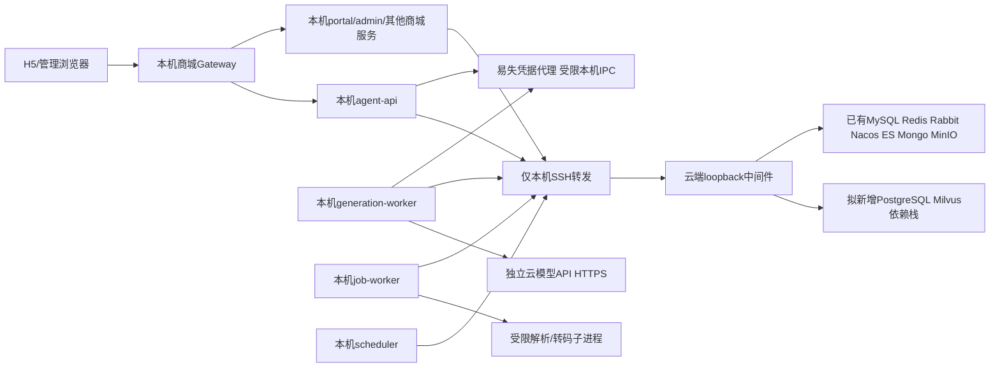

# 智能体部署运维与验收设计

架构v0.2，2026-11-11。本文是目标部署方案，保留设计时的候选与建议。后续已实施PG、真实模型接入及Milvus独立栈，实际版本、端口、资源采样和验证范围见 [10-模型接入与依赖验收](../10-模型接入与依赖验收.md)。下列完整容量、备份与恢复要求仍须分阶段验收。

## 1 目标拓扑与边界

保留“本机应用、云端中间件”的需求部署方式。新增agent-api建议127.0.0.1:8099，凭据IPC建议Windows受限命名管道；若采用本机端口，必须认证、限制来源并独立管理秘密。不要默认在0.0.0.0暴露。Java gateway是浏览器统一入口；外部不直接连接Python管理接口、Java桥接、PG、Milvus或对象存储管理台。

SSH转发由现有deployment管理方式扩展，绑定本机loopback；禁止数据库端口开放公网作为故障绕行。云端Docker发布也绑定127.0.0.1。隧道启动成功后还需逐依赖握手检查，不能用SSH进程存在代表数据库可用。记录隧道断线时普通查询、SSE与确认核对的降级行为。

已核对的Docker数据根为/opt/mallpilot/docker-data；新增持久卷、备份路径和空间计算以实际docker inspect为准。Milvus的元数据/对象存储依赖按所选发行部署清单固定，不将现有商城MinIO未经隔离直接作为内部依赖；即使复用实例，也须独立桶、独立账号和恢复计划。

## 2 进程与权限

| 进程 | 职责 | 并发起点 | 故障隔离 |
|---|---|---|---|
| agent-api | 普通HTTP、鉴权SSE、确认首次发送、内存凭据代理 | 首版1个应用进程 | 多进程扩展先解决broker路由，不能简单增加workers |
| generation-worker | 领取run、图执行、可见输出 | 3个生成协程，PG全局槽位3 | 单run异常不退出其他run |
| job-worker | 解析、索引、媒体、清理、结果核对 | 核对2、解析1、索引1、清理1为上限建议 | 独立队列限流，解析子进程有CPU/内存/时间限额 |
| scheduler | 租约回收、到期扫描、任务补唤醒、清理周期 | 1个活跃leader | 备用实例通过PG选主，任务仍唯一键去重 |
| Java业务outbox发布器 | 延迟取消/业务通知可靠发布 | 短批次循环 | 不阻塞Java请求，失败保留行 |
| 备份执行器 | 受控备份/隔离校验任务 | 1个预登记作业 | 不运行UI提交的命令或任意路径 |

Windows后台进程由现有启停脚本/服务管理器扩展，隐藏辅助窗口并保存受限日志。所有进程使用同一构建号、同一契约版本和数据库迁移版本。worker采用心跳、租约和fencing防止失联实例再次提交旧状态。

PostgreSQL分迁移账号、运行账号、checkpoint账号和备份只读/受控账号；运行账号不能任意建表、删schema或读取库外秘密。MySQL桥接仍由Java业务账号访问，Python不直接读写商城表。MinIO私有桶按聊天、知识、媒体缓存用途分前缀/桶并最小授权；向量集合按环境及embedding维度隔离。

## 3 版本与兼容验证

| 项目 | 设计基线/候选 | 实施门槛 |
|---|---|---|
| Java/商城 | 当前Java17、Spring Boot3.5.14及现有锁定源码 | 保持现有构建与回归，具体版本取source-lock和pom |
| Python | 需求固定3.13 | 独立环境，不用参考项目3.14替换 |
| Web | FastAPI、Pydantic2、Uvicorn、HTTPX | 锁补丁版本，流式取消/文件上传兼容测试 |
| 数据层 | PostgreSQL16、SQLAlchemy2、Alembic、psycopg异步方案 | 驱动与连接池方案择一固定，事务/时区/大ID测试 |
| 编排 | LangGraph与AsyncPostgresSaver锁定组合 | setup、检查点恢复、删除命名空间与升级兼容 |
| 向量 | 原需求候选Milvus3.0.5 / PyMilvus3.0.2 Standalone | 保留原候选，不声称已可运行；核验真实发行、客户端/依赖栈、维度/过滤/重建 |
| 消息与存储 | 既有Rabbit3.13、Redis7、MinIO | 独立vhost/ACL/桶；连接失败恢复 |
| 文档 | pypdf、python-docx，受限媒体工具 | 扫描PDF明确失败，恶意/超大文件测试 |
| 对话模型 | 保留需求gpt-6.1-sol | 独立供应商凭据验证实际模型名、协议和能力 |
| 其他模型 | 沿用需求指定阿里云能力 | URL、地域、额度、数据用途与输出Schema实际验证 |

候选版本不是已验证组合。之前依赖解析通过不能证明运行兼容；官方OpenAI文档访问403也不能证明模型可用或不可用。S0输出实际版本、锁文件、兼容报告和不可用功能清单。协议适配失败时相关能力不激活，不能静默改模型绕过要求。

## 4 云端容量与连接预算

前次只读采样8核、15.1GiB内存、约11GiB可用、约30GiB空闲磁盘，只说明当时有部分余量。新增Milvus栈可能包含多个进程，不能只估算一个容器。数据库、向量、原件、日志、备份、镜像和临时解析全部计入磁盘。

| 对象 | 起点预算建议 | 必须测量 |
|---|---|---|
| PG | 内存约1GiB起，连接上限80为候选 | shared_buffers/work_mem/实际连接和查询延迟 |
| Milvus完整栈 | 合计约3–5GiB起测 | 元数据与对象存储、加载集合、索引峰值 |
| 既有中间件余量 | 不压缩到当前静态占用值 | MySQL/ES峰值、JVM、page cache |
| 系统安全余量 | 建议至少2GiB | OOM、swap、CPU steal和SSH延迟 |
| 磁盘 | 建议保留至少20%空闲 | 峰值构建、WAL、备份副本与日志增长 |

这不是承诺可共存的资源配置。若容量不满足，先减少测试数据/并行构建或调整部署资源，再进行容量验收，不能靠关闭持久化和备份达标。

PG连接池建议API 5+2溢出、generation 4+1、job 5+2、scheduler 1+1、checkpoint 3+1，总上限约25；保留迁移、运维与恢复连接。SSE轮询按批读取并复用池，不为13个在线用户分别持有长事务。Java业务连接和PG连接独立计量，避免长事务等待网络。

容量模型记录：每天会话数×平均消息数×平均正文/事件字节；知识原件+父子文本+向量（数量×维度×4字节）再加索引/元数据开销；图片按原件与处理副本；音频按码率×时长。向量公式只提供下限，不包含索引实际开销。每次大批构建前计算额外旧/新两代共存空间。

## 5 配置与秘密

| 配置组 | 公开配置项 | 秘密与校验 |
|---|---|---|
| APP | env、build、graph_version、bind、base_path | 生产环境禁debug与详细堆栈 |
| PG | host/port/database/pool/schema | 密码库外注入；启动校验迁移版本 |
| BRIDGE | portal/admin内部URL、timeout、key_id | HMAC密钥、receipt密钥分离；端点白名单 |
| MODEL | capability、provider、model_name、endpoint_ref、options | secret_version_ref映射到受限秘密存储；普通API只显示已配置 |
| QUOTA | 能力/主体/日额度、各单位上限 | 配置变更版本化，计费未知保守预留 |
| STREAM | heartbeat、poll、replay_days、batch_limit | 不允许任意放大单响应 |
| RUN | global3、per_conversation1、deadline180s、step16、tool12 | 后台改配置不能绕过硬上限 |
| FILE | 类型/字节/像素/时长/页数/解析timeout | MinIO凭据、受限转码路径不接受前端覆盖 |
| RETENTION | text90d、image90d、audio7d、speech7d | 缩短期限先试算与确认 |
| JOB | 类型并发、lease、retry/backoff | 重试不授予新的业务权限 |
| BACKUP | 已登记目标、保留周期、校验策略 | 加密密钥与备份分离、恢复账号受限 |

Nacos可继续承载现有非秘密配置；不要把所有新密钥塞进前端可读的Nacos配置或Git。开发环境可用受ACL保护的本机秘密文件/系统凭据设施，部署时再选择受控秘密服务。生产秘密字节不落数据库、检查点、普通日志、备份说明或截图。

启动配置以Pydantic强类型校验。endpoint_ref解析到预登记HTTPS域名，禁止任意URL、防SSRF与内网探测；请求附件不能让模型自行抓取外部链接。代理、重定向、DNS解析和媒体外部引用均需受控。跨环境配置、桶、vhost、向量集合和密钥不能混用。

## 6 健康检查、启动与退出

内部/livez只证明进程事件循环存活；/readyz检查构建/迁移、PG、身份桥接基础能力及必需配置。按能力展示知识/媒体/模型降级状态，不能因TTS不可用让文字人工全部下线。探针不执行真实付费调用，不创建报价、订单或样例消息，不把secret/完整连接串返回给普通访问者。

启动顺序：验证配置与秘密引用 → 建立隧道和依赖握手 → 受控执行一次迁移 → 初始化版本化checkpoint schema → Java桥接与网关权限就绪 → agent-api → job/generation → scheduler → readiness通过后接入浏览器。迁移采用单独进程，不能每个worker启动时重复执行DDL。

退出先取消readiness与新消息/确认接收，再通知SSE重连，允许已提交首次执行有有限时间返回；剩余未知转核对。生成worker停止领新run，保存可见部分并标INTERRUPTED，释放槽位；清理/解析worker保存批次进度，未完成不ACK；scheduler释放选主。杀进程情况下仍由租约回收和fencing补偿，退出钩子不能成为唯一保障。

## 7 任务、定时器与一致性扫描

| 扫描 | 周期起点建议 | 去重/恢复规则 |
|---|---|---|
| QUEUED run与空闲槽位 | 1秒 | 仅持有有效身份上下文的run可开始 |
| dispatch结果核对 | 2秒及next_attempt_at | 原action唯一；只核对/封闭 |
| 过期run/job租约 | 10秒 | 先递增fencing再恢复/中断 |
| 待处理ag_job补唤醒 | 5秒 | 消息仅是提示，PG事实去重 |
| 员工心跳过期 | 10秒 | 展示离线，不自动转交 |
| 过期action | 30秒 | 仅待确认卡可EXPIRED |
| 事件前缀清理 | 每小时 | 更新replay_floor与删除原子提交 |
| 留存试算/分批清理 | 每日低负载 | policy_version+cutoff+batch唯一 |
| 孤儿对象/失效引用扫描 | 每日 | 保护窗口后核对PG与Java，再删除 |
| Java业务outbox | 1秒 | event_key唯一，发布可重复、业务消费幂等 |
| 备份与验证 | 每日/每周候选 | 预登记执行器，无任意shell |

定时任务晚到只降低时效，不能引入重复业务。scheduler中不直接进行长解析和全库清理，它只创建幂等job。清理和备份以小批次、可暂停、进度可观察执行，避免与咨询抢占全部数据库连接与磁盘IO。

## 8 可观测性与告警

结构化日志包含timestamp、env、build、request_id、actor_kind、脱敏actor_id、conversation/run/action/operation/job、module、error_code、duration_ms。仅在受限审计中保留必要责任ID；普通日志不打印完整body、Authorization、receipt、HMAC或供应商原始响应。审计查询自身留痕。

| 指标 | 展示/告警建议 | 处理 |
|---|---|---|
| 普通接口P95 | 目标<1秒，独立统计桥接与SSH | 分析锁等待/连接池/网络，不混入模型等待 |
| 首字与完整回答耗时 | 分别统计路由、工具、模型、缓冲 | 以真实样本报告，不预设供应商SLA |
| 生成槽位/排队时长 | 占用3时第4个排队；等待>60秒提示 | 检查僵尸租约和供应商延迟 |
| SSE补传/410/缺口 | 缺口需重同步；突然增加告警 | 检查时钟实现、清理和代理缓冲 |
| UNKNOWN数量与年龄 | >10分钟警告，>1小时人工关注 | 核对原编号，禁止点重试执行 |
| job失败与积压 | 分类型，连续失败3次提示 | 检查依赖、格式或资源，按权限重试 |
| 模型用量/预留/未知 | 分单位与能力，不混加 | 对账后有审计地结算，不能批量清零 |
| PG事务/锁/池 | 长事务、时钟等待和池耗尽 | 检查外部IO是否误入事务 |
| 云端内存/磁盘 | 起点内存>85%、磁盘空闲<20% | 限新构建/上传，扩容或受控清理 |
| 最近有效备份/恢复 | 超过策略周期即异常 | 失败记录可见，不能显示绿色成功 |

错误率按身份失败、业务确定拒绝、系统异常分别计算；正常的库存不足和用户停止不混入系统故障率。统计聚合时注明UTC窗口与界面时区，模型usage缺失显示未知。

## 9 备份与隔离恢复

### 9.1 备份清单

包含MySQL商城数据及operation/dedupe/outbox/售后保护引用、PG客服schema+checkpoint schema+时钟+配置历史+dispatch、MinIO原件与附件元数据、知识活动代际/embedding配置版本、迁移版本、构建号、非秘密配置及删除标记。Milvus可从PG/原件重建，仍须记录重建版本、数量和耗时；不能只备向量而丢原文。

演示环境建议每日备份、保留7日并每周另存一份，候选RPO24小时、RTO4小时；它们是待实测并评审的运维目标。备份应加密且至少一份位于同服务器之外，云盘同目录复制不构成独立故障恢复能力。密钥单独保管，保留版本以便核对receipt加密信封；普通用户无法下载备份。

### 9.2 一致备份窗口

首版采用短维护窗口：停止新确认/员工业务写/知识发布和清理，等待在途Java事务完成；未知operation清单单独记录；暂停调度与消费者但保存持久状态，建立MySQL与PG一致点和MinIO对象清单，再备份。若允许商城其他入口继续写入，就不能宣称跨库是同一时间点，必须增加数据库日志/PITR及业务核对策略后再验收。

备份清单记录各库时间/LSN或binlog位置、时钟last_event_id/replay_floor、对象数量与哈希、活动版本、未知操作、未完成job、删除标记水位。秘密不写入明文清单。备份成功只表示文件生成且校验可读，完整恢复通过另记结果。

### 9.3 恢复顺序

1. 创建隔离网络、库、桶和模型禁调用环境，全部执行/消费默认关闭。
2. 校验备份签名、哈希、版本和解密权限，恢复MySQL、PG、对象清单及字节。
3. 优先重放比备份更新的删除标记和保护引用，校正可见性与memory_epoch。
4. 校验FK、消息seq、事件时钟和对象引用，重建必要Milvus集合并核验活动版本。
5. 将恢复的RUNNING标INTERRUPTED、回收槽位；未完成dispatch只核对Java原编号，不能execute。恢复缺失操作按03分册封闭；无完整MySQL操作账本时禁止业务写重新开放。
6. outbox只在对应业务状态重新核验后恢复发布；延迟取消仍用订单合法条件竞争。
7. 核对样例会话、接待、来源、附件、已执行与未知操作、已删除内容。记录实际RPO/RTO。
8. 获得发布流程所需授权后开放正常流量；本次设计阶段不执行此步骤。

restore不自动重放图检查点的写节点、不因旧job恢复再次收费/提交业务、不把旧Bearer从备份带回来。遇到跨库时间差，优先以Java操作账本判定业务事实，再修PG投影；不能反向按AI聊天文字重造订单。

## 10 迁移、发布与回退

S0先在隔离PG16/MySQL8.0.35执行设计DDL、框架setup和测试数据，检查真实语法、约束、索引及执行计划。当前v1文件尚未部署，可更新目标稿；一旦实施必须转为版本化迁移，之后增量添加，不重复整份执行。

采用扩展后切换：新增可空字段/表与兼容读取 → 部署支持新旧的Java/服务 → 回填可确定的数据 → 验证并切新写 → 后续单独收紧约束。历史售后不自动猜order_item_id；MySQL DDL隐式提交，失败不能假设整批回滚。先估算锁表影响和备份恢复路径。

应用回退需兼容已写入的新字段/枚举；不能把已确认的action、operation或不可变配置历史删除回到旧快照。发布前冻结新确认，先部署Java桥接及网关权限，再Python，再前端；业务写开关仅在全链路验收后打开。前端与服务契约版本不兼容时禁止继续确认旧卡。

## 11 测试分层与证据

| 层 | 核对内容 | 通过证据 |
|---|---|---|
| 静态设计 | 映射、Schema引用、DDL结构、权限、状态枚举 | design/architecture-validation.json；仅设计结论 |
| 单元与属性规则 | 金额守恒、数量守恒、状态转换、规范化哈希 | 边界/反例/生成样例，不能只镜像实现 |
| 契约 | 116operation、事件判别、DTO、大ID/金额/时区 | Java/Python/前端同测试向量 |
| 真实依赖集成 | PG锁序、MySQL竞态、MQ重复、MinIO权限、Milvus过滤 | 隔离环境数据前后对比与真实SQL结果 |
| 供应商兼容 | 流式、工具、结构化、取消、usage、六能力 | 独立凭据，脱敏request_id与实际结果 |
| UI端到端 | 页面状态、键盘/读屏、窄屏、附件与音频 | 真浏览器录屏/截图与场景记录 |
| 故障与恢复 | F01–F27、备份隔离恢复 | 注入窗口、数据库事实、最终状态 |
| 全量验收 | A01–A15及P0/P1/P2 | 每项通过/失败/未测/供应商受限明确记录 |

A08容量使用10个买家和3个客服，持续至少15分钟，混合咨询、排队、人工、历史、附件和业务核对；同时3个run，第4个可取消，同会话第二个run受限。采集普通接口P50/P95/P99、模型首字/总时长、锁等待、连接池、CPU/内存/磁盘、错误与重复副作用。不得通过关闭审计/持久化获得“通过”。

UI验收覆盖B01–B05、A01–A05的loading/empty/error/forbidden/stale/unknown/offline状态，手机窄屏键盘、44px点击区域、可见label、焦点返回、流式阅读与大列表。当前原型逻辑检查仅使用Node存根，浏览器访问受工具限制而未完成，不能把CSS或字符串检查记为视觉通过。

## 12 运维手册与发布门槛

| 手册 | 操作重点 | 结束条件 |
|---|---|---|
| RB01 依赖/隧道断线 | 检查连通和身份，不放开公网 | 依赖就绪、SSE补传与核对恢复 |
| RB02 UNKNOWN处理 | 原operation只核对；receipt过期续签 | 得到真实终态或保留明确人工状态 |
| RB03 知识构建失败 | 查看解析/配置/空间，保留旧活动版本 | 新版本质检与发布或明确失败 |
| RB04 额度/模型不可用 | 关单能力、保留人工、核对未知计费 | 有审计地调整额度/激活已验证配置 |
| RB05 客服离线 | 保留归属、主管转交、更新epoch | 真实员工可回复，无旧AI输出 |
| RB06 清理误差/孤儿 | 先查保护引用与tombstone，不直接删桶 | 引用一致、已删内容不复活 |
| RB07 磁盘/OOM | 停构建/上传、保护数据库、校验持久状态 | 稳定余量与任务可恢复 |
| RB08 备份恢复 | 隔离、禁execute、重放删除、核对账本 | A14证据与实际RPO/RTO |
| RB09 版本回退 | 冻结新确认、检查枚举与迁移兼容 | 数据保留且旧应用安全读取 |

完整发布门槛：所有需求及A01–A15有结果，所有越权/重复副作用/资源不一致缺陷关闭，供应商限制明确，兼容版本固定，恢复演练通过，普通日志无秘密，所有新增管理资源默认拒绝，真实UI与容量测试完成。阶段发布使用08计划的子集门槛，不冒充完整成品验收。
